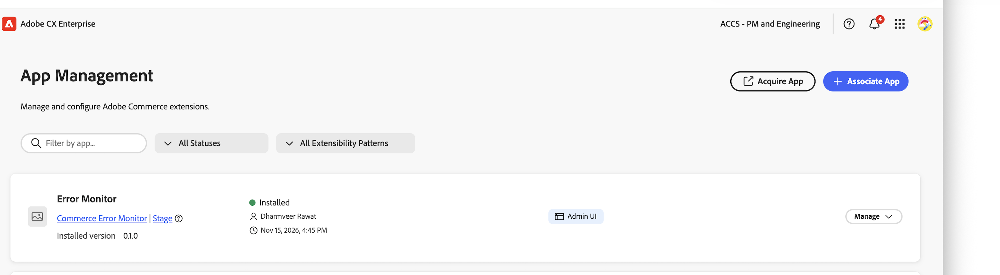
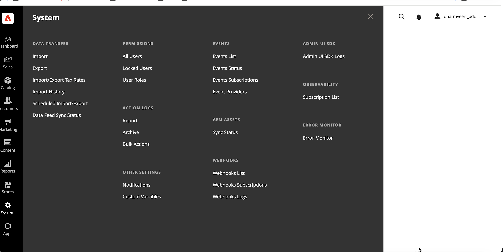
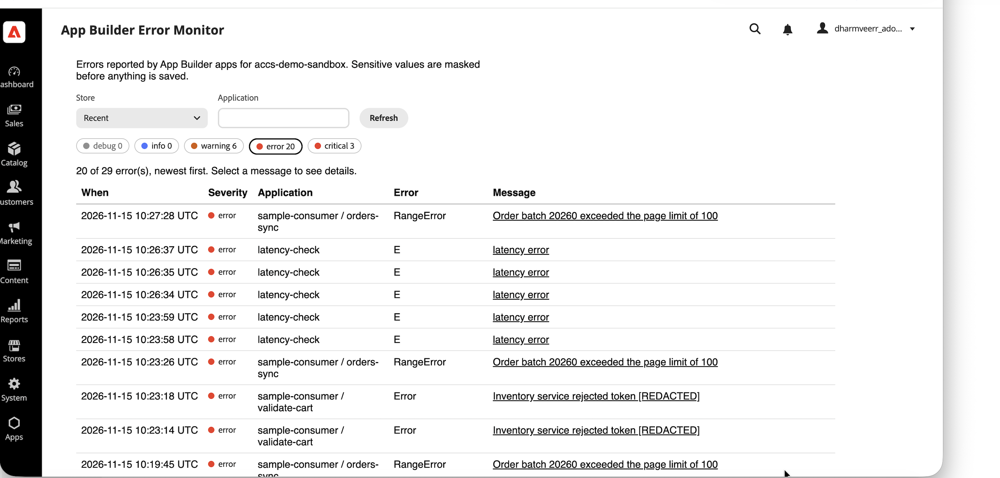
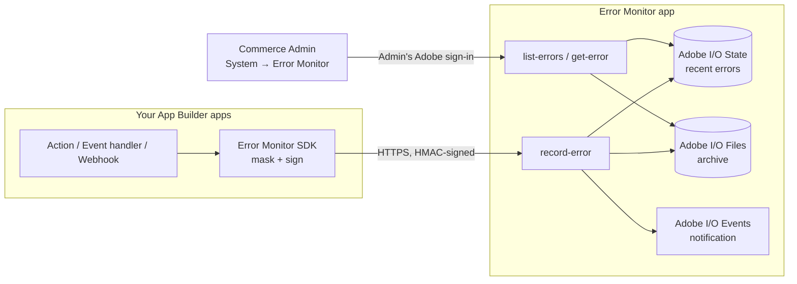

# Commerce App Builder Error Monitor

A reusable error-monitoring solution for Adobe Commerce **App Builder** applications. Any App Builder action can report errors through a small shared package. Errors are cleaned of sensitive data, stored, archived and announced, and Commerce administrators can review them on a dashboard inside the Commerce Admin.

Built for **Adobe Commerce as a Cloud Service (ACCS)**, including sandbox instances. The dashboard uses **Admin UI SDK V2** (`commerce/backend-ui/2`) and is installed through **App Management**.

## Features

| Capability | Description |
|---|---|
| **Shared SDK** | `@commerce-ext/error-monitor-sdk` adds error reporting to an existing action with one wrapper. It has no runtime dependencies. Wrappers are available for normal actions, I/O Events handlers and Commerce webhooks. |
| **Sensitive-data protection** | Passwords, tokens, API keys, authorization headers, emails, card numbers and credentials in URLs are masked. Masking runs in the reporting app, again in the monitor, and again before display. Only a fixed set of fields is accepted, so request bodies and headers are never stored. |
| **Signed ingestion** | Reports are signed with HMAC-SHA256 and a timestamp. The monitor rejects unsigned, altered or replayed-late requests. |
| **Recent errors** | Stored in Adobe I/O State with a configurable retention period (default 7 days). |
| **Archive** | A copy of every error is written to Adobe I/O Files, organized by day. |
| **Notifications** | An Adobe I/O Events notification is published for errors at or above a configurable severity. |
| **Admin dashboard** | **System → Error Monitor** in Commerce Admin: list, filter by severity and application, browse the archive by day, and open full error details. |
| **Fail-safe reporting** | Reporting never breaks the calling action. It has a short timeout, no retries and per-error throttling. |

## How it looks

**1. Installed in Commerce** (Apps → App Management)



**2. Menu entry** (System → Error Monitor)



**3. Dashboard with recent errors and severity counts**



## Architecture



## Repository layout

| Path | Contents |
|---|---|
| [packages/error-monitor-sdk](packages/error-monitor-sdk) | The shared SDK package |
| [apps/error-monitor](apps/error-monitor) | The Error Monitor App Builder app: `record-error`, `list-errors`, `get-error` and the Commerce Admin dashboard |
| [apps/sample-consumer](apps/sample-consumer) | A separate sample app that uses the SDK: one normal action (`orders-sync`) and one Commerce webhook (`validate-cart`) |
| [scripts/smoke-test.js](scripts/smoke-test.js) | Automated end-to-end check against a deployed environment |
| [docs](docs) | Setup, SDK usage, solution design, demo guide and test results |

## Requirements

- Node.js 22 or 24, and the Adobe I/O CLI (`npm install -g @adobe/aio-cli`)
- An Adobe Commerce as a Cloud Service instance (a sandbox is fine), with the Admin UI SDK enabled
- An App Builder project in Adobe Developer Console, in the **same Adobe organization** as the Commerce instance

## Quick start

The full procedure is in **[docs/setup-and-installation.md](docs/setup-and-installation.md)**.

```bash
git clone <repository-url> commerce-appbuilder-error-monitor
cd commerce-appbuilder-error-monitor
npm install
npm test

cd apps/error-monitor
aio app use                 # select your App Builder project and workspace
# add the settings below to .env
aio app deploy
```

Then, in Commerce Admin, go to **Apps → App Management → Associate App**, select the project and workspace, and **Install**. The dashboard appears under **System → Error Monitor**.

## Configuration

Settings for the Error Monitor app go in `apps/error-monitor/.env`. A template is in [apps/error-monitor/.env.example](apps/error-monitor/.env.example).

| Setting | Required | Description |
|---|---|---|
| `COMMERCE_INSTANCE_ID` | Yes | Label for the Commerce instance this deployment serves. Allowed characters: letters, digits, `_`, `-`; up to 64 characters. |
| `INGEST_SIGNING_KEY` | Yes | Shared signing key, at least 32 characters (`openssl rand -hex 32`). Reporting apps use the same value. Keep it secret. |
| `IMS_ORG_ID` | Yes | Adobe organization ID (`<id>@AdobeOrg`) whose administrators may view the dashboard. |
| `STATE_TTL_SECONDS` | No | Retention period for recent errors. Default `604800` (7 days). |
| `ARCHIVE_ENABLED` | No | Write each error to the Files archive. Default `true`. |
| `EVENT_PROVIDER_ID` | For notifications | Adobe I/O Events provider ID. Setting it turns notifications on. |
| `EVENT_CODE` | No | Event type. Default `com.example.commerce.error_monitor.error_recorded`. |
| `EVENT_MIN_SEVERITY` | No | Lowest severity that triggers a notification: `debug`, `info`, `warning`, `error` (default) or `critical`. |
| `IMS_CLIENT_ID`, `IMS_CLIENT_SECRET`, `IMS_SCOPES` | For notifications | OAuth Server-to-Server credential used to publish events. Treat `IMS_CLIENT_SECRET` as a secret. |

## Adding error monitoring to an App Builder app

1. Install the SDK in the app's root folder (see [docs/using-the-sdk-in-your-project.md](docs/using-the-sdk-in-your-project.md) for the release link).
2. Add `ERROR_MONITOR_ENDPOINT` (the `record-error` URL) and `ERROR_MONITOR_SIGNING_KEY` as action inputs.
3. Wrap the action:

```js
const { withErrorMonitor } = require('@commerce-ext/error-monitor-sdk');

exports.main = withErrorMonitor(main, {
  source: { app: 'orders-integration', action: 'sync-orders', version: '1.0.0', environment: 'stage' },
});
```

Use `withWebhookErrorMonitor` for Commerce webhooks. It always answers Commerce with a valid webhook operation and never sends internal error text to shoppers.

## Security

- **Reporting** is authenticated with an HMAC-SHA256 signature and a 5-minute timestamp window.
- **Dashboard data actions** require a valid Adobe IMS token (`require-adobe-auth`). The page receives the administrator's token from the Commerce Admin only.
- **Sensitive values** are masked at three points: in the reporting app, in the monitor before storage, and again before display. Masking is pattern-based, so application code should still avoid putting secrets in error messages.
- **Access scope:** in this release, any Commerce administrator who can use Admin UI SDK apps can open the dashboard, and any valid Adobe sign-in from the configured organization can call the data actions. Role-based restrictions are planned for a later release (see [docs/solution-design.md](docs/solution-design.md#7-current-scope-and-roadmap)).
- **No secrets in source control:** `.env` files are excluded by `.gitignore`.

## Documentation

| Document | Purpose |
|---|---|
| [Setup and installation](docs/setup-and-installation.md) | Step-by-step deployment to an ACCS sandbox |
| [Using the SDK in your project](docs/using-the-sdk-in-your-project.md) | Add error reporting to existing actions, event handlers and webhooks |
| [Solution design](docs/solution-design.md) | Architecture, data model, interfaces and security model |
| [High-level design](docs/high-level-design.md) | System context, building blocks, main flows and deployment view |
| [Low-level design](docs/low-level-design.md) | Modules, functions, settings, storage layout, validation rules and limits |
| [Demo guide](docs/demo-guide.md) | Guided demonstration with expected results |
| [Test results](docs/test-results.md) | Automated test and build verification, acceptance checks |
