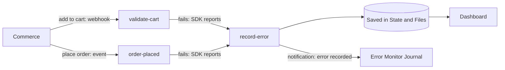

# Demo Guide

A guided demonstration of the Error Monitor, about 15 minutes. Each step lists the command or action and the expected result.

## Before the demo

- The Error Monitor is deployed and installed in Commerce Admin ([setup guide](setup-and-installation.md), sections 4–5).
- The sample app is deployed to its own workspace with `ERROR_MONITOR_ENDPOINT` and `ERROR_MONITOR_SIGNING_KEY` set (setup guide, section 6).
- You are signed in with `aio login` and the CLI points at the **sample app's** workspace (run the commands from `apps/sample-consumer`).
- Commerce Admin is open on **System → Error Monitor**.
- Optional: the Error Monitor Journal is open in Developer Console (see step 8).
- **Warm-up, 5 minutes before the demo:** run step 3 once. The first call after a period of inactivity starts the actions and takes a few seconds; later calls respond in about a second.

The Error Monitor must show **Installed** in **Apps → App Management**, and **Error Monitor** must appear under **System**:


**How to invoke the sample action.** Invoke it without waiting for the result, then read the result of the last activation:

```bash
aio runtime action invoke sample-consumer/orders-sync --param simulate <mode>
aio runtime activation result --last
```

Do not use `--result` / `--blocking` for the failing modes: when an action ends with an error, the CLI retries a blocking call, so one demo step would record the same error up to three times.

---

## 1. Reuse in an existing app (2 min)

Open [`apps/sample-consumer/actions/orders-sync/index.js`](../apps/sample-consumer/actions/orders-sync/index.js).

- The business function `syncOrders` is ordinary code.
- The only integration is the `require` of the SDK and the `withErrorMonitor(...)` export.
- [`app.config.yaml`](../apps/sample-consumer/app.config.yaml) passes two inputs: `ERROR_MONITOR_ENDPOINT` and `ERROR_MONITOR_SIGNING_KEY`.

## 2. A successful call is not recorded

```bash
aio runtime action invoke sample-consumer/orders-sync --param simulate ok
aio runtime activation result --last
```

**Expected:** `{ "statusCode": 200, "body": { "synced": 3 } }`. After **Refresh**, the dashboard shows no new entry.

## 3. An unexpected error is recorded

```bash
aio runtime action invoke sample-consumer/orders-sync --param simulate fail
aio runtime activation result --last
```

**Expected:** a generic `500` with `"error": "Internal Server Error"` and an `errorId`. After **Refresh**, a `RangeError` from `sample-consumer / orders-sync` appears at the top of the list. Open it: its **Record ID** equals the `errorId`.

## 4. Sensitive values are masked

```bash
aio runtime action invoke sample-consumer/orders-sync \
  --param simulate leak --param customerEmail jane.doe@example.com
aio runtime activation result --last
```

**Expected:** the new entry's message reads `Upstream rejected request for [REDACTED_EMAIL]: Authorization: Bearer [REDACTED]`. The detail view shows **Hidden values** with the number of masked values. Neither the email address nor the token is stored or displayed.

## 5. A returned error response is recorded

```bash
aio runtime action invoke sample-consumer/orders-sync --param simulate unavailable
aio runtime activation result --last
```

**Expected:** the action returns its own `503` response unchanged. The dashboard shows an `ErrorResponse (503)` entry with the message `Action returned HTTP 503: Order service is unavailable`.

### Warning and critical severity

```bash
aio runtime action invoke sample-consumer/orders-sync --param simulate warning
aio runtime action invoke sample-consumer/orders-sync --param simulate critical
aio runtime activation result --last
```

**Expected:** each call returns `statusCode 200` with `recordedSeverity` and an `errorId`. After **Refresh**, the dashboard lists both entries and the **Warning** and **Critical** chips show their counts. Select a chip to filter the list.

A `warning` is saved and shown in the dashboard, but it does not create a notification (step 8), because notifications start at `error`. A `critical` does create one.

## 6. Commerce webhook behaviour

`validate-cart` is a Commerce webhook example protected by Adobe IMS. Call it with your own IMS token.

**Find the values** (run from `apps/sample-consumer`):

```bash
aio app get-url       # use the URL that ends with /sample-consumer/validate-cart
aio console org list  # the org's code, for example 1234567890ABCDEF@AdobeOrg
```

**Simple call:**

```bash
curl -s -X POST "<validate-cart URL>" \
  -H "Authorization: Bearer $(aio login --bare)" \
  -H "x-gw-ims-org-id: <org-id>@AdobeOrg" \
  -H "content-type: application/json" \
  -d '{"simulate":"fail"}'
```

**All three cases** with a helper:

```bash
TOKEN=$(aio login --bare)
URL=<validate-cart URL>
ORG=<org-id>@AdobeOrg
call() { curl -s -X POST "$URL" -H "Authorization: Bearer $TOKEN" -H "x-gw-ims-org-id: $ORG" -H 'content-type: application/json' -d "$1"; echo; }

call '{"cart":{"items":[{"qty":2}]}}'     # normal cart
call '{"cart":{"items":[{"qty":60}]}}'    # business rule
call '{"simulate":"fail"}'                # unexpected error
```

**Expected:**

| Call | Response | Recorded |
|---|---|---|
| Normal cart | `{"op":"success"}` | No |
| Business rule | `{"op":"exception","message":"Carts are limited to 50 items."}` | No (a business outcome, not an error) |
| Unexpected error | `{"op":"exception","message":"We could not check your cart right now. Please try again. (reference <id>)"}` | Yes; the record shows `token [REDACTED]`, and the response contains no internal error text |

All three responses use HTTP 200, as Commerce webhooks require.

## 7. Dashboard features


1. **Severity chips:** select a chip to filter the list; select it again to clear the filter. The counts reflect the loaded list.
2. **Application filter:** type `sample-consumer` (or paste an *Application* cell such as `sample-consumer / orders-sync`) and select **Refresh**.
3. **Details:** select a message to open the stack, fingerprint, request information, tags and storage location (*Recent (State)*). Select **Close details**.
4. **Archive:** set **Store** to **Archive (by day)**, keep today's date and select **Refresh**. The same errors are listed from the Files archive.
5. **Empty result:** set **Application** to `no-such-app` and select **Refresh**. The page shows *"No errors match these filters…"* instead of an empty table.

## 8. Notifications (Adobe I/O Events)

Besides saving an error, the Error Monitor can publish a short **notification** for it. Other tools can subscribe to these notifications, for example to forward critical errors to a chat or ticket tool.

### 8.1 How it fits with the other steps



The dashboard and the notification are two separate outputs of the same saved error:

| Output | What it is | Who uses it |
|---|---|---|
| **Dashboard** | The saved errors, read from I/O State and Files | Administrators |
| **Notification** | A short message "an error was recorded", published through Adobe I/O Events | Other systems that subscribe to it |

A notification is sent only for errors at or above `EVENT_MIN_SEVERITY` (default `error`). It has the error ID, severity, application, action, error name and the first 200 characters of the message. It has no stack trace and no request details.

### 8.2 The terms

| Term | In this project |
|---|---|
| **Event** | The notification message: "an error was recorded" |
| **Provider** | The sender of the event. Here: **Commerce Error Monitor** |
| **Event code** | The name of the event type: `com.example.commerce.error_monitor.error_recorded` |
| **Registration** | A subscription: "send me this event, delivered this way" |
| **Journal** | A delivery method. Adobe keeps the events in a list that can be read at any time. Here: **Error Monitor Journal** |

Commerce also uses events to tell our app that an order was placed (the `order-placed` action). That is a different event. The journal in this step only receives **"error recorded"** events.

### 8.3 Trigger an error

Run from `apps/sample-consumer`.

**Order sync (event handler):**

```bash
aio runtime action invoke sample-consumer/orders-sync --param simulate fail
```

The command prints only an `activationId`. That is normal: it starts the action and does not wait for the result.

**Add to cart (webhook).** Use the `call` helper from step 6:

```bash
call '{"simulate":"fail"}'
```

The reply is `{"op":"exception","message":"We could not check your cart right now. Please try again. (reference <id>)"}`.

Wait about 30 seconds.

### 8.4 See the error in the dashboard

In **System → Error Monitor**, select **Refresh**. The new error is at the top. Open it and note its **Record ID**.

### 8.5 See the notification in the journal

1. Open Adobe Developer Console → **Commerce Error Monitor** → workspace **Stage** → **Error Monitor Journal**.
2. Open the **Event Browser** tab.
3. The journal is read in batches, starting with the oldest event. Select **Go to next batch** until you reach the newest events.
4. Open the newest event. Its `data` contains the error details:

```json
"data": {
  "errorId": "2026111...",
  "severity": "error",
  "app": "sample-consumer",
  "action": "orders-sync",
  "errorName": "RangeError",
  "message": "Order batch 20260 exceeded the page limit of 100"
}
```

**Expected:** `errorId` equals the **Record ID** from the dashboard (step 8.4). The same error is now visible in two places.

| Event Browser item | Meaning |
|---|---|
| **Last read position** | A bookmark. The next batch continues after it. |
| **Go to next batch** | Loads the next set of events |
| **Adjust batch size** | Changes how many events are loaded at once |
| **Copy cURL request** | Copies the request that reads the journal, to run it from a terminal |

### 8.6 Send a sample event from the Console

This tests the journal without running any app.

1. Open **Error Monitor Journal** (step 8.5, point 1).
2. On the **Registration Details** tab, find **Subscribed Events**. In the row **Error recorded**, select the paper-plane icon.
3. A window shows a sample event. You can edit it, but `source` and `type` cannot be changed.
4. Select **Send sample event**.
5. Open **Event Browser** and go to the newest batch. The sample event is listed.

A sample event has `"data": {}` (empty), unless you edit it. An event from the Error Monitor always has the error details in `data`. This is how to tell them apart.

### 8.7 Good to know

| Tab in the registration | What it is for |
|---|---|
| **Event Browser** | Shows the events stored in the journal |
| **Event Filtering** | Lets a registration receive only some events, for example only `severity` = `critical`, or only one application |
| **Debug Tracing** | Shows delivery attempts to a **webhook** URL. It is available for webhook registrations, so it stays disabled for a journal. |

`EVENT_MIN_SEVERITY` in the Error Monitor settings decides which errors are published at all. Event Filtering decides which of those events each registration receives.

## 9. Automated end-to-end check

From the repository root, run `npm run smoke` as described in the setup guide, section 7. Each acceptance check prints `PASS`.

---

## Summary of what was shown

| Requirement | Demonstrated in |
|---|---|
| Shared package reused by a separate app without changing business logic | Steps 1, 3–6 |
| Errors normalized to one schema | Steps 3–7 (detail view), step 9 |
| Recent errors in State, archived errors in Files | Step 7 (Recent and Archive) |
| Events notification for a tested error | Step 8 |
| Dashboard details, empty and invalid results handled | Step 7 |
| Warning and critical entries shown and filtered | Step 5 (warning and critical), step 7 |
| Sensitive values not exposed | Steps 4 and 6 |
