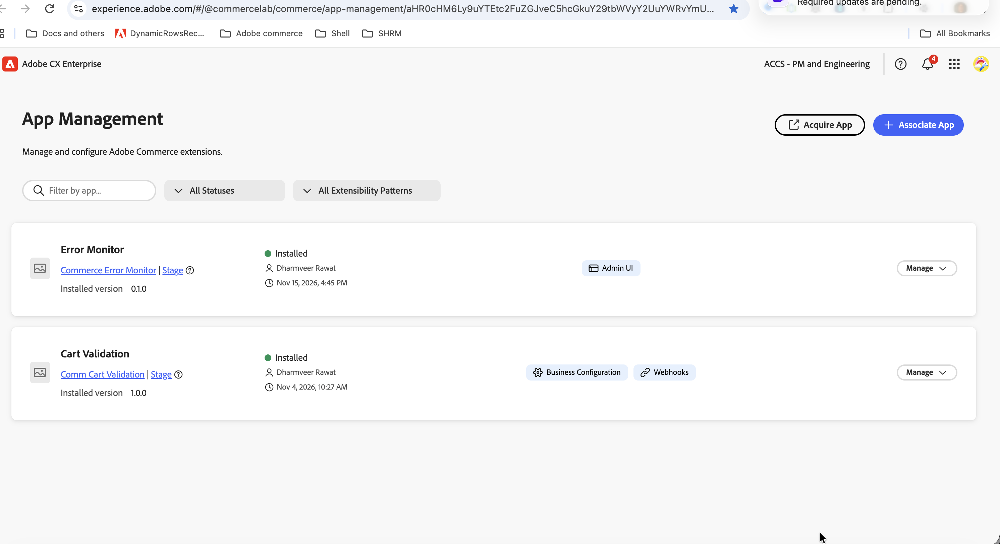
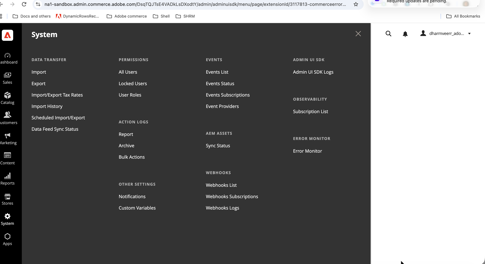
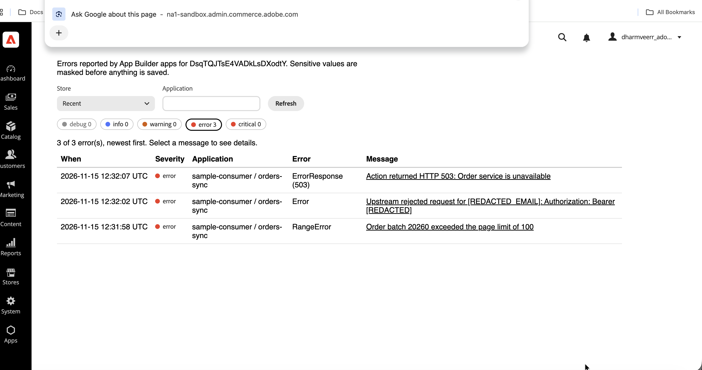
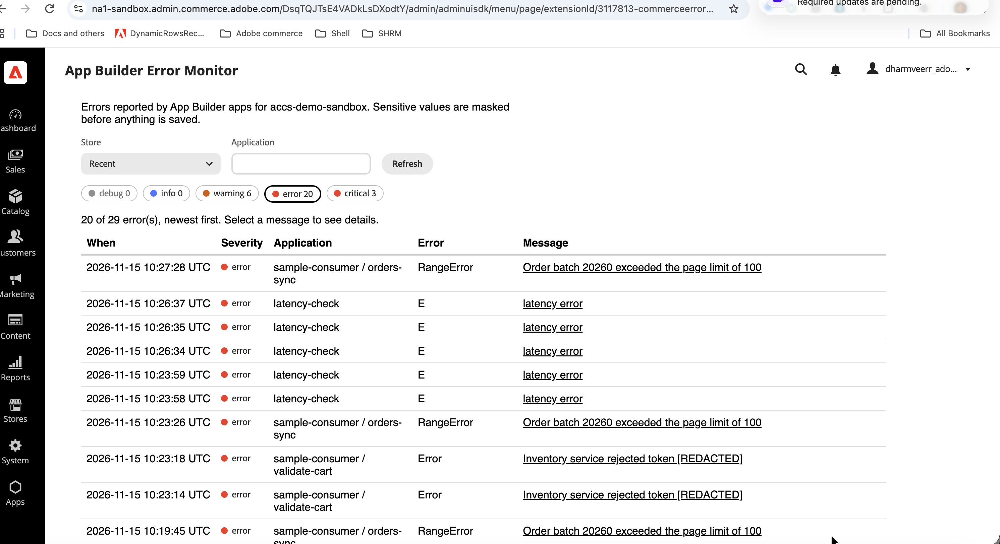

# Demo Guide

A guided demonstration of the Error Monitor, about 15 minutes. Each step lists the command or action and the expected result.

## Before the demo

- The Error Monitor is deployed and installed in Commerce Admin ([setup guide](setup-and-installation.md), sections 4–5).
- The sample app is deployed to its own workspace with `ERROR_MONITOR_ENDPOINT` and `ERROR_MONITOR_SIGNING_KEY` set (setup guide, section 6).
- You are signed in with `aio login` and the CLI points at the **sample app's** workspace (run the commands from `apps/sample-consumer`).
- Commerce Admin is open on **System → Error Monitor**.
- Optional: an Events journal registration is open in Developer Console.
- **Warm-up, 5 minutes before the demo:** run step 3 once. The first call after a period of inactivity starts the actions and takes a few seconds; later calls respond in about a second.

The Error Monitor must show **Installed** in **Apps → App Management**, and **Error Monitor** must appear under **System**:





**How to invoke the sample action.** Invoke it without waiting for the result, then read the result of the last activation:

```bash
aio runtime action invoke sample-consumer/orders-sync --param simulate <mode>
aio runtime activation result --last
```

Do not use `--result` / `--blocking` for the failing modes: when an action ends with an error, the CLI retries a blocking call, so one demo step would record the same error up to three times.

---

## 1. Reuse in an existing app (2 min)

Open [`apps/sample-consumer/actions/orders-sync/index.js`](../apps/sample-consumer/actions/orders-sync/index.js).

- The business function `syncOrders` is ordinary code.
- The only integration is the `require` of the SDK and the `withErrorMonitor(...)` export.
- [`app.config.yaml`](../apps/sample-consumer/app.config.yaml) passes two inputs: `ERROR_MONITOR_ENDPOINT` and `ERROR_MONITOR_SIGNING_KEY`.

## 2. A successful call is not recorded

```bash
aio runtime action invoke sample-consumer/orders-sync --param simulate ok
aio runtime activation result --last
```

**Expected:** `{ "statusCode": 200, "body": { "synced": 3 } }`. After **Refresh**, the dashboard shows no new entry.

## 3. An unexpected error is recorded

```bash
aio runtime action invoke sample-consumer/orders-sync --param simulate fail
aio runtime activation result --last
```

**Expected:** a generic `500` with `"error": "Internal Server Error"` and an `errorId`. After **Refresh**, a `RangeError` from `sample-consumer / orders-sync` appears at the top of the list. Open it: its **Record ID** equals the `errorId`.

## 4. Sensitive values are masked

```bash
aio runtime action invoke sample-consumer/orders-sync \
  --param simulate leak --param customerEmail jane.doe@example.com
aio runtime activation result --last
```

**Expected:** the new entry's message reads `Upstream rejected request for [REDACTED_EMAIL]: Authorization: Bearer [REDACTED]`. The detail view shows **Hidden values** with the number of masked values. Neither the email address nor the token is stored or displayed.

## 5. A returned error response is recorded

```bash
aio runtime action invoke sample-consumer/orders-sync --param simulate unavailable
aio runtime activation result --last
```

**Expected:** the action returns its own `503` response unchanged. The dashboard shows an `ErrorResponse (503)` entry with the message `Action returned HTTP 503: Order service is unavailable`.

After steps 3–5, the dashboard looks like this (newest first): the `503` response, the masked email and token, and the `RangeError`.



## 6. Commerce webhook behaviour

`validate-cart` is a Commerce webhook example protected by Adobe IMS. Call it with your own IMS token (replace the URL with the one shown by `aio app get-url`):

```bash
TOKEN=$(aio login --bare)
URL=<validate-cart URL>
ORG=<org-id>@AdobeOrg
call() { curl -s -X POST "$URL" -H "Authorization: Bearer $TOKEN" -H "x-gw-ims-org-id: $ORG" -H 'content-type: application/json' -d "$1"; echo; }

call '{"cart":{"items":[{"qty":2}]}}'     # normal cart
call '{"cart":{"items":[{"qty":60}]}}'    # business rule
call '{"simulate":"fail"}'                # unexpected error
```

**Expected:**

| Call | Response | Recorded |
|---|---|---|
| Normal cart | `{"op":"success"}` | No |
| Business rule | `{"op":"exception","message":"Carts are limited to 50 items."}` | No (a business outcome, not an error) |
| Unexpected error | `{"op":"exception","message":"We could not check your cart right now. Please try again. (reference <id>)"}` | Yes; the record shows `token [REDACTED]`, and the response contains no internal error text |

All three responses use HTTP 200, as Commerce webhooks require.

## 7. Dashboard features



1. **Severity chips:** select a chip to filter the list; select it again to clear the filter. The counts reflect the loaded list.
2. **Application filter:** type `sample-consumer` (or paste an *Application* cell such as `sample-consumer / orders-sync`) and select **Refresh**.
3. **Details:** select a message to open the stack, fingerprint, request information, tags and storage location (*Recent (State)*). Select **Close details**.
4. **Archive:** set **Store** to **Archive (by day)**, keep today's date and select **Refresh**. The same errors are listed from the Files archive.
5. **Empty result:** set **Application** to `no-such-app` and select **Refresh**. The page shows *"No errors match these filters…"* instead of an empty table.

## 8. Notifications

In the Developer Console Events journal, each recorded error at or above `EVENT_MIN_SEVERITY` (default `error`) appears as one event with a summary: ID, severity, application, action, error name and a shortened message. Stack traces and context are not included.

## 9. Automated end-to-end check

From the repository root, run `npm run smoke` as described in the setup guide, section 7. Each acceptance check prints `PASS`.

---

## Summary of what was shown

| Requirement | Demonstrated in |
|---|---|
| Shared package reused by a separate app without changing business logic | Steps 1, 3–6 |
| Errors normalized to one schema | Steps 3–7 (detail view), step 9 |
| Recent errors in State, archived errors in Files | Step 7 (Recent and Archive) |
| Events notification for a tested error | Step 8 |
| Dashboard details, empty and invalid results handled | Step 7 |
| Sensitive values not exposed | Steps 4 and 6 |
