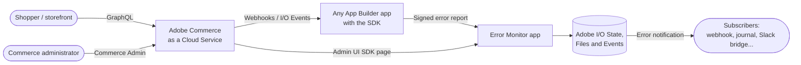
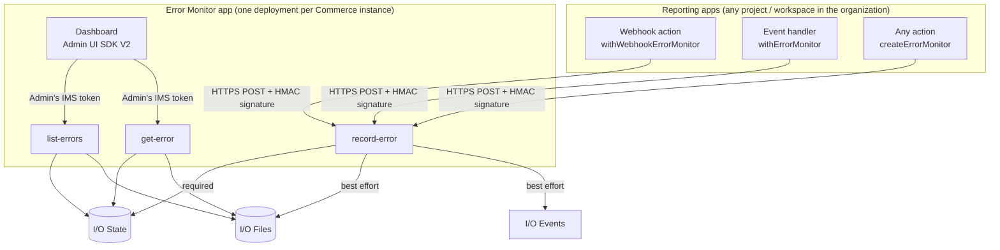
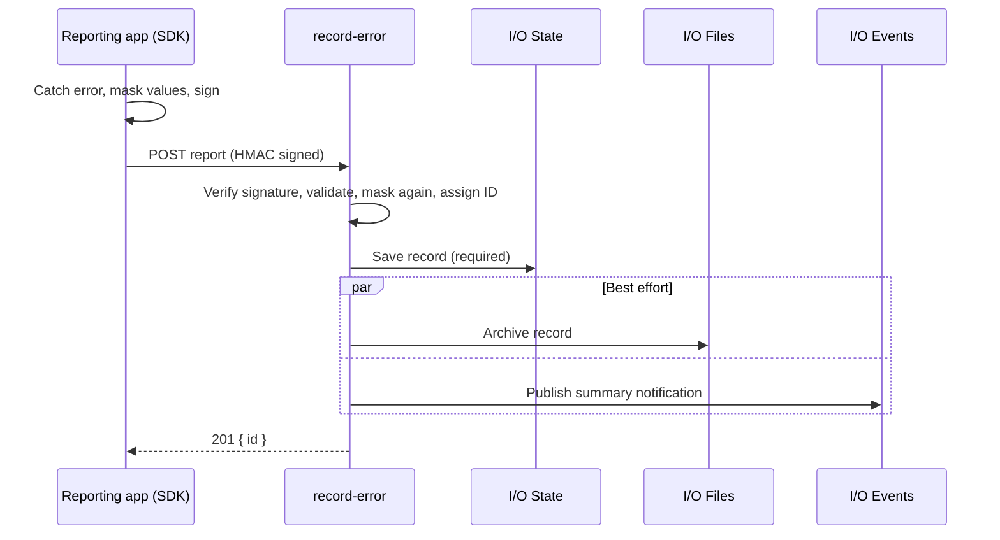
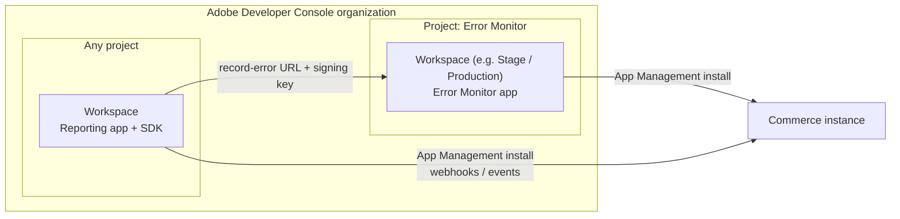

# High-Level Design (HLD) – Commerce App Builder Error Monitor

Version 1.0 · Applies to SDK 0.1.0 and Error Monitor app 0.1.0

Related documents: [Low-level design](low-level-design.md) · [Solution design](solution-design.md) · [Setup and installation](setup-and-installation.md)

## 1. Purpose

App Builder apps that extend Adobe Commerce run as separate serverless actions. When one fails, the details stay in that action's activation logs. Commerce administrators cannot see those logs, and the logs may contain sensitive data.

The Error Monitor gives every App Builder app one simple way to report errors, and gives administrators one place in the Commerce Admin to review them.

## 2. Goals

- One reusable SDK for any App Builder action, event handler or webhook
- Sensitive values masked before anything is stored
- Recent errors searchable; every error archived
- Notification for each error through Adobe I/O Events
- Dashboard inside the Commerce Admin
- Monitoring never breaks the monitored app

## 3. System context

## 4. Building blocks

| Block | What it is | Main job |
|---|---|---|
| **Error Monitor SDK** | npm package `@commerce-ext/error-monitor-sdk`, no runtime dependencies | Wraps an action, masks sensitive values, signs and sends the report. It never throws. |
| **`record-error` action** | App Builder web action, signed requests only | Checks the signature, masks again, saves, archives and publishes a notification |
| **`list-errors` / `get-error` actions** | App Builder web actions, Adobe sign-in required | Return masked records to the dashboard |
| **Dashboard** | Admin UI SDK V2 page under **System → Error Monitor** | Lists, filters and shows error details |
| **Adobe I/O State** | Key-value store with expiry | Recent errors (default 7 days) |
| **Adobe I/O Files** | Private file storage | Long-term archive, one file per error |
| **Adobe I/O Events** | Event provider of the Error Monitor | One summary notification per error |
| **Sample app** | Separate App Builder app (separate workspace) | Shows reuse: a cart webhook and an order event handler that report through the SDK |

## 5. Architecture

## 6. Main flows

### 6.1 Recording an error

### 6.2 Webhook failure (shopper adds a product)

1. The shopper adds a product to the cart. Commerce calls the app's webhook action.
2. The action fails unexpectedly. The SDK records the error and answers Commerce with a valid webhook response.
3. The shopper sees a friendly message with a reference ID. The internal error text is never shown.
4. The administrator finds the same reference ID on the dashboard.

### 6.3 Event handler failure (order placed)

1. The order is placed. Checkout is not affected.
2. Adobe I/O Events delivers `observer.sales_order_place_after` to the app's event handler.
3. The handler fails (for example, the ERP rejects the order). The SDK records the error, with tokens masked.
4. The error appears on the dashboard.

### 6.4 Reviewing errors

The administrator opens **System → Error Monitor**. The page uses the administrator's existing Adobe sign-in to call `list-errors` and `get-error`, then shows recent errors with filters and a detail view.

## 7. Security overview

| Risk | How it is handled |
|---|---|
| Secrets or personal data in error text | Masked three times: in the SDK, in `record-error` and on output. Only a fixed set of fields is accepted. |
| Fake or replayed reports | HMAC-SHA256 signature, 5-minute time window, 64 KB size limit |
| Reports filed under another instance | Instance and record ID are set by the server only |
| Unauthorized dashboard access | Adobe IMS token checked by the platform, plus an organization check |
| Shoppers seeing internal errors | The webhook wrapper sends only a fixed customer message and a reference |
| Monitoring slowing down or breaking apps | Short timeouts, no exceptions from the SDK, throttling of repeated errors |

## 8. Deployment view

- One Error Monitor deployment per Commerce instance.
- Reporting apps need only two settings: the `record-error` URL and the signing key.
- Both apps are installed in Commerce through **Apps → App Management**.

## 9. Quality attributes

| Attribute | Approach |
|---|---|
| Reliability | Saving to State is the only required step. Archive and notification failures never lose the record. |
| Performance | Archive and notification run in parallel. Webhook reporting uses a short timeout so the Commerce limit is respected. |
| Scalability | Records are partitioned by day. List requests have fixed read limits. |
| Maintainability | One SDK shared by all apps. The server re-validates everything, so older SDK versions keep working. |
| Testability | Storage, events and time are injectable. Automated tests cover the SDK, the actions and the dashboard logic. |

## 10. Key decisions

| Decision | Reason |
|---|---|
| Signed reports (HMAC) instead of IMS for apps | Reporting apps live in other projects; no IMS credentials need to be shared. |
| Server re-masks everything | Reporting apps cannot be trusted to mask correctly. |
| Notification contains a summary only | Subscribers never receive stack traces or context. |
| Separate webhook wrapper | Commerce webhooks need HTTP 200 with an operation. Internal errors must not reach shoppers. |
| Admin UI SDK V2 with App Management | The supported model for Adobe Commerce as a Cloud Service. |
