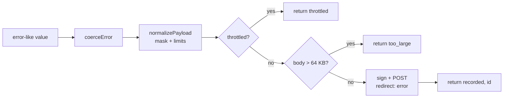
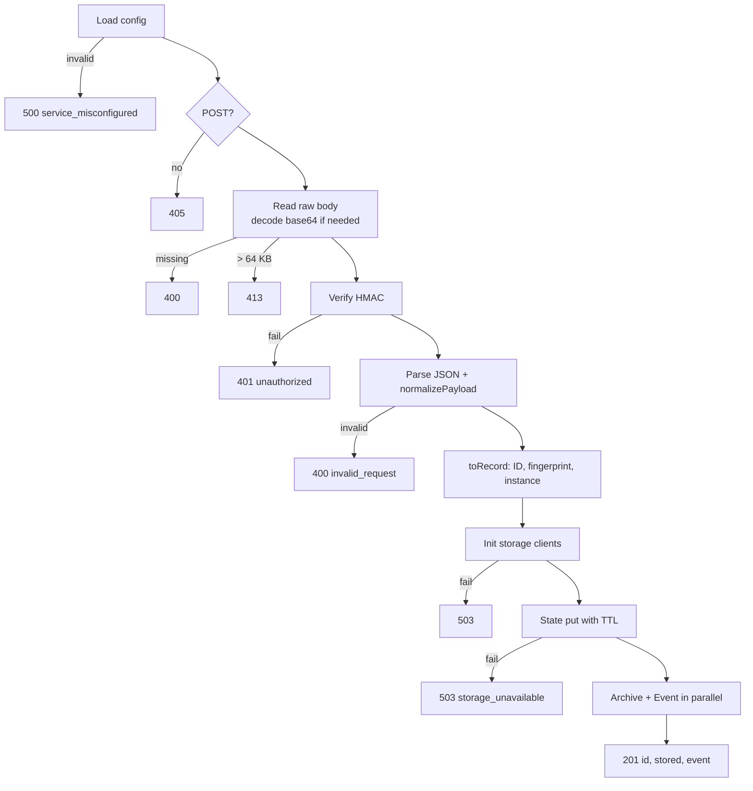

# Low-Level Design (LLD) – Commerce App Builder Error Monitor

Version 1.0 · Applies to SDK 0.1.0 and Error Monitor app 0.1.0

Related documents: [High-level design](high-level-design.md) · [Solution design](solution-design.md) · [Using the SDK in your project](using-the-sdk-in-your-project.md)

## 1. Repository structure

```text
packages/error-monitor-sdk/          Shared SDK (npm workspace)
  schema/error-record.v1.schema.json ErrorRecord JSON schema
  src/constants.js                   Schema version, severities, limits, header names
  src/sanitize.js                    Masking of sensitive text
  src/normalize.js                   Payload validation and normalization
  src/record.js                      ID, fingerprint, record build and validation
  src/signing.js                     HMAC signing and verification
  src/client.js                      createErrorMonitor and the two wrappers
apps/error-monitor/                  Error Monitor app (Admin UI SDK V2)
  app.commerce.config.ts             App metadata and Admin menu entry
  src/commerce-backend-ui-2/
    ext.config.yaml                  Actions, inputs and annotations
    actions/record-error|list-errors|get-error/index.js
    actions/lib/                     config, ingest, query, stores, events, output, http, defaults
    web-src/src/                     Dashboard (app.jsx, pages/main-page.jsx, lib/viewModel.js)
apps/sample-consumer/                Sample reporting app (webhook + event handler)
scripts/smoke-test.js                End-to-end check against a deployed Error Monitor
scripts/commerce-flow.js             Real storefront flow through Commerce GraphQL
```

## 2. SDK

### 2.1 Public API

| Export | Signature | Behaviour |
|---|---|---|
| `createErrorMonitor(options)` | returns `{ record(error, opts), isConfigured() }` | `record()` never throws. It returns `{ recorded, id?, reason? }`. |
| `withErrorMonitor(handler, opts)` | wraps an action `main` | Thrown error: records it and returns `500 { error, errorId }`. Returned 5xx: records it as `ErrorResponse` and returns the response unchanged. |
| `withWebhookErrorMonitor(handler, opts)` | wraps a webhook `main` | Thrown error: records it and returns HTTP 200 with `op: exception` (with a reference) or `op: success`. |
| `optionsFromParams(params)` | `{ endpoint, signingKey }` | Reads `ERROR_MONITOR_ENDPOINT` and `ERROR_MONITOR_SIGNING_KEY` from the action inputs. |

### 2.2 `createErrorMonitor` options

| Option | Default | Notes |
|---|---|---|
| `endpoint` | – | Must be `https` (plain `http` only for localhost with `allowInsecureLocalhost`) |
| `signingKey` | – | Shared HMAC key, at least 32 characters |
| `source` | – | `{ app, action?, version?, environment? }` |
| `timeoutMs` | `3000` | Request is aborted after this time |
| `throttle` | `{ maxPerWindow: 5, windowMs: 60000 }` | Per fingerprint, per warm container. At most 500 keys are tracked. |
| `fetchImpl` | global `fetch` | Injectable for tests |
| `onTransportError` | no-op | Local logging hook |

`record()` reasons when nothing is sent: `not_configured`, `throttled`, `too_large`, `http_<status>`, `transport_error`.

### 2.3 Wrapper options

| Option | Wrapper | Default | Notes |
|---|---|---|---|
| `source` | both | – | Reported application and action |
| `recordErrorResponses` | `withErrorMonitor` | `true` | Also records returned 5xx responses |
| `onError` | webhook | `'exception'` | `'exception'` stops the Commerce operation; `'success'` lets it continue |
| `customerMessage` | webhook | generic text | 1–200 characters. Shown to shoppers with ` (reference <id>)`. |
| `timeoutMs` | webhook | `1000` | Keep below the webhook `soft_timeout` |
| `resolveOptions` | both | `optionsFromParams` | Custom source of endpoint and key |

### 2.4 Record flow inside `record()`



### 2.5 Masking (`sanitize.js`)

Masking is applied in this order to every free-text field:

1. Private key blocks (`-----BEGIN ... PRIVATE KEY-----`).
2. JWTs (`eyJ...`).
3. `Bearer` / `Basic` credentials (the scheme word is kept).
4. Credentials in URLs (`//user:pass@`).
5. Sensitive query parameters (`token=`, `api_key=`, `password=`, ...).
6. Labelled values (`password: x`, `token=x`).
7. Label followed by a space and a value of 8+ characters with letters and digits (`token tok_9fA2...`).
8. Known key formats: AWS, Stripe, GitHub, Google API keys.
9. Email addresses → `[REDACTED_EMAIL]`.
10. Card numbers that pass the Luhn check → `[REDACTED_PAN]`.
11. Opaque strings of 40+ URL-safe characters → `[REDACTED_TOKEN]`.

Control characters are removed. Each change increases the redaction count. Tag values under sensitive keys (`password`, `token`, `secret`, `authorization`, `cvv`, ...) are replaced completely.

### 2.6 Normalization (`normalize.js`)

| Field | Rule |
|---|---|
| `severity` | `debug`, `info`, `warning`, `error`, `critical`. The SDK changes an invalid value to `error`; the server rejects it. |
| `source.app`, `source.action` | `^[A-Za-z0-9@][\w.@/ -]{0,99}$` |
| `error.name` / `code` / `message` | Masked; at most 100 / 100 / 1,000 characters |
| `error.stack` | At most 30 lines and 4,000 characters, masked |
| `timestamp` | Accepted between 30 days ago and 5 minutes ahead; otherwise server time |
| `context` | Only `requestId`, `activationId`, `http.{method, path, status}` and up to 20 `tags`. The query string is removed from `path`. All other keys are dropped. |

### 2.7 Signing (`signing.js`)

- Headers: `x-em-timestamp: <unix seconds>` and `x-em-signature: v1=<hex>`.
- Signature: `HMAC-SHA256(key, "<timestamp>.<raw body>")`.
- Verification: timestamp format `^\d{9,12}$`, tolerance ±300 s, signature format `^v1=[0-9a-f]{64}$`, constant-time comparison.
- Failure reasons (logged only): `no_key_configured`, `missing_headers`, `bad_timestamp`, `stale_timestamp`, `bad_signature_format`, `signature_mismatch`.

### 2.8 Record identity (`record.js`)

- **ID:** `yyyymmddHHMMssSSS-xxxxxxxx` (UTC time plus 8 random hex characters). Sorting by ID sorts by time.
- **Fingerprint:** first 32 hex characters of SHA-256 over `app | action | name | code | message | top stack frame`. Before hashing, UUIDs, hex values and numbers in the message are replaced with `#`, and line/column numbers are removed from the frame.
- **`validateRecord`:** strict check of every stored field. Unknown fields make the record invalid.

## 3. Error Monitor actions

### 3.1 Action configuration (`ext.config.yaml`)

| Action | `web` | Annotations | Limits |
|---|---|---|---|
| `record-error` | yes | `require-adobe-auth: false`, `raw-http: true`, `final: true` | 30 s, 256 MB |
| `list-errors` | yes | `require-adobe-auth: true`, `final: true` | default |
| `get-error` | yes | `require-adobe-auth: true`, `final: true` | default |

All actions use `nodejs:22`.

### 3.2 Settings (`lib/config.js`)

| Setting | Used by | Default | Validation |
|---|---|---|---|
| `COMMERCE_INSTANCE_ID` | all | – | `^[A-Za-z0-9_-]{1,64}$` |
| `INGEST_SIGNING_KEY` | `record-error` | – | At least 32 characters |
| `IMS_ORG_ID` | read actions, events | – | `<id>@AdobeOrg` |
| `STATE_TTL_SECONDS` | `record-error` | `604800` (7 days) | 60 – 31,536,000 |
| `ARCHIVE_ENABLED` | all | `true` | boolean |
| `EVENTS_ENABLED` | `record-error` | `true` if a provider ID is set | boolean |
| `EVENT_PROVIDER_ID`, `EVENT_CODE`, `EVENT_MIN_SEVERITY` | `record-error` | code `com.example.commerce.error_monitor.error_recorded`, severity `error` | Required when events are enabled |
| `IMS_CLIENT_ID`, `IMS_CLIENT_SECRET`, `IMS_SCOPES`, `IMS_TOKEN_URL` | `record-error` | scopes `openid,AdobeID,adobeio_api` | Token URL must be `https` |

Invalid settings return `500 service_misconfigured`. The log lists setting names only, never values.

### 3.3 `record-error` (`lib/ingest.js`)



- **Raw body:** Runtime base64-encodes JSON bodies for `raw-http` actions. The body is decoded unless the content type is `text/*` or the body already starts with `{` or `[`.
- **Redaction count:** server count plus the count reported by the SDK (accepted only as an integer 0–1000).
- **Response:** `201 { id, stored: { state, archive }, event: { emitted, reason? } }`. `reason` is `disabled`, `below_threshold` or `publish_failed`.

### 3.4 Storage (`lib/stores.js`)

| Store | Key or path | Notes |
|---|---|---|
| State | `e.<instance>.<yyyymmdd>.<id>` | Expires after `STATE_TTL_SECONDS` |
| Files | `error-monitor/<instance>/<yyyy>/<mm>/<dd>/<id>.json` | Private storage, no expiry |

Listing limits:

| Constant | Value | Meaning |
|---|---|---|
| `MAX_SCAN_KEYS` | 5,000 | Keys read per day; sorted newest first |
| `MAX_FETCH` | 300 | Records read per list request |
| `READ_BATCH` | 20 | Parallel reads |
| `FILES_PAGE` | 1,000 | Files listed per day folder |

`listRecent` walks back day by day until it has `limit` matching records. `truncated` is `true` when a limit stopped the scan.

Clients (`lib/defaults.js`) are created once per warm container. A failed initialization is not cached.

### 3.5 Notification (`lib/events.js`)

- Sent only when events are enabled and the severity is at least `EVENT_MIN_SEVERITY`.
- CloudEvents 1.0: `type` = `EVENT_CODE`, `source` = `urn:uuid:<providerId>`, `id` = record ID, `time` = `receivedAt`.
- `data`: `errorId`, `fingerprint`, `commerceInstanceId`, `severity`, `app`, `action`, `errorName`, `message` (first 200 characters). No stack and no context.
- IMS token: client credentials grant, cached per container until 60 s before expiry.

### 3.6 `list-errors` and `get-error` (`lib/query.js`)

1. Load settings in read mode.
2. Check that `x-gw-ims-org-id` equals `IMS_ORG_ID` (the platform has already validated the IMS token). Otherwise `403 forbidden`.
3. Validate parameters before any storage call.
4. Read, keep only valid records of the configured instance, mask again (`lib/output.js`).

| Parameter | Action | Rule |
|---|---|---|
| `source` | both | `state` (default) or `archive` |
| `limit` | list | 1–100, default 25 |
| `days` | list | 1–31, default 7 (State only) |
| `severity` | list | One of the severities |
| `app` | list | Same pattern as `source.app` |
| `date` | list | `YYYY-MM-DD`, required for `archive` |
| `id` | get | `^\d{17}-[0-9a-f]{8}$` |

`get-error` reads State first, then the archive. The list returns summaries only: ID, time, severity, fingerprint, app, action, name, code and the first 200 characters of the message.

### 3.7 Response codes

| Code | Body `error` | When |
|---|---|---|
| 201 | – | Record saved |
| 200 | – | List or detail returned |
| 400 | `invalid_request` | Invalid body or parameters (`details` lists problems, never values) |
| 401 | `unauthorized` | Bad or missing signature |
| 403 | `forbidden` | Organization does not match |
| 404 | `not_found` | Record missing, invalid or from another instance |
| 405 | `method_not_allowed` | `record-error` called without POST |
| 409 | `archive_disabled` | Archive requested while disabled |
| 413 | `payload_too_large` | Body over 64 KB |
| 500 | `service_misconfigured` | Invalid settings |
| 503 | `storage_unavailable` | State or Files not available |

## 4. Dashboard

### 4.1 Bootstrap

- `app.commerce.config.ts` declares one menu entry, `error_monitor_dashboard`, under **System**.
- `app.jsx` calls `createExtensionApp({ menu: <MainPage />, metadata })` from `@adobe/aio-commerce-lib-admin-ui/web`.
- Build note: the aio build compiles JSX in development mode (`jsxDEV`). `package.json` maps `react/jsx-dev-runtime` to `web-src/src/jsx-dev-runtime.js`, which re-exports the production `jsx` function.

### 4.2 Page logic (`pages/main-page.jsx`)

| Part | Behaviour |
|---|---|
| Sign-in | `useIms()` returns the administrator's IMS token and organization. Without it, the page shows a notice. |
| Calls | `fetch(actionUrl, { Authorization: Bearer, x-gw-ims-org-id })`. Action URLs come from `useConfig().getActionUrl`. |
| Filters | **Store** (Recent / Archive by day), **Day**, **Application**. Text filters apply on **Refresh**. |
| Application filter | `app / action` is split by `parseAppFilter`. `app` is sent to the server; `action` is filtered in the page. |
| Severity chips | Counts per severity; selecting a chip filters the shown rows |
| Old responses | A request counter (`requestSeq`) ignores responses of older requests |
| Detail | `get-error` result shown as a definition list and the stack |
| Safety | All text is rendered as React text; there is no HTML injection point |

### 4.3 View model (`lib/viewModel.js`)

Pure functions, tested without a browser: `buildQuery`, `parseAppFilter`, `parseListResponse`, `parseDetailResponse`, `severityCounts`. Invalid records are counted and hidden, with a notice.

## 5. Sample app (`apps/sample-consumer`)

| Item | Value |
|---|---|
| App ID | `error-monitor-sample` |
| Webhook | `observer.sales_quote_add_item` (before) → `sample-consumer/validate-cart`; fields `sku`, `qty`, `quote_id` from `data.quote_item`; timeout 5,000 ms, soft timeout 3,000 ms, not required |
| Event | `plugin.sales.api.order_management.place` → `sample-consumer/order-placed`, all fields |
| `validate-cart` | `withWebhookErrorMonitor`, `onError: 'exception'`, `timeoutMs: 3000`. A SKU in `FAIL_ADD_TO_CART_SKUS` simulates an inventory failure. More than 50 units is a normal business rejection. |
| `order-placed` | `withErrorMonitor`. A SKU in `FAIL_ORDER_SYNC_SKUS` simulates an ERP failure that contains a bearer token (masked when stored). |
| `orders-sync` | Non-web demo action with modes `ok`, `fail`, `leak`, `unavailable` |

Settings: `ERROR_MONITOR_ENDPOINT`, `ERROR_MONITOR_SIGNING_KEY`, `UPSTREAM_TOKEN` (demo value), `FAIL_ADD_TO_CART_SKUS`, `FAIL_ORDER_SYNC_SKUS`.

## 6. Limits summary

| Item | Limit |
|---|---|
| Request body | 64 KB |
| Message / stack | 1,000 characters / 30 lines and 4,000 characters |
| Tags | 20 per record; key 40, value 200 characters |
| Signature time window | ±5 minutes |
| Client throttle | 5 reports per fingerprint per minute per container |
| List page | 1–100 records; at most 300 reads per request |

## 7. Testing

| Suite | Covers |
|---|---|
| `packages/error-monitor-sdk/test` | Masking patterns, normalization, signing, wrappers, throttling |
| `apps/error-monitor/test` | Ingest, query, events, Admin UI config, view model, integration with fakes |
| `apps/sample-consumer/test` | Webhook payload, order event, failure simulation |
| `scripts/smoke-test.js` | Deployed `record-error`, State copy, masking |
| `scripts/commerce-flow.js` | Real cart and order through Commerce GraphQL |

Run all automated tests with `npm test`.
