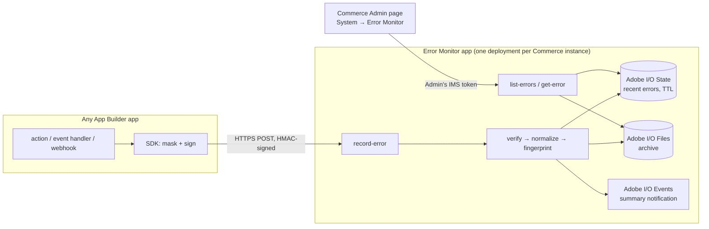

# Solution Design – Commerce App Builder Error Monitor

Version 1.0 · Applies to SDK 0.1.0 and Error Monitor app 0.1.0

## 1. Overview

App Builder applications that extend Adobe Commerce run as independent serverless actions. When one of them fails, the details usually stay in that action's activation logs, which Commerce administrators cannot see and which may contain sensitive data.

The Error Monitor provides one consistent way to:

1. **Record** errors from any App Builder action, with sensitive values removed before anything leaves the action.
2. **Keep** recent errors queryable and archive every error durably.
3. **Notify** subscribers through Adobe I/O Events.
4. **Review** errors in a dashboard inside the Commerce Admin.

## 2. Architecture

### Components

| Component | Technology | Responsibility |
|---|---|---|
| SDK `@commerce-ext/error-monitor-sdk` | Node.js package, no dependencies | Wraps actions, masks sensitive values, signs and sends error reports; never interferes with the calling action |
| `record-error` | App Builder web action | Verifies the signature, re-validates and re-masks the report, stores, archives and notifies |
| `list-errors`, `get-error` | App Builder web actions, Adobe IMS authentication | Serve the dashboard; filter, validate and re-mask records on output |
| Dashboard | Admin UI SDK V2 menu page, React Spectrum 2 | Lists, filters and shows error details inside the Commerce Admin |

### Deployment model

One Error Monitor deployment serves one Commerce instance. The instance label (`COMMERCE_INSTANCE_ID`) is configuration and is stamped on every record by the server, so a reporting app cannot file errors under another instance. Reporting apps can live in any App Builder project or workspace of the same organization; they need only the `record-error` URL and the signing key.

### Recording flow

1. Verify the HMAC signature and the timestamp (±5 minutes).
2. Validate and normalize the payload to the `ErrorRecord` schema, masking sensitive values again. The server never relies on masking done by the reporting app.
3. Assign the server-side ID, fingerprint and instance label.
4. **Store in State.** This step is required; if it fails, the caller receives `503`.
5. **Archive in Files** and **publish the Events notification** (if the severity meets the threshold). Failures in these steps are logged and reported in the response, and never lose the stored record.
6. Respond `201 { id, stored: { state, archive }, event: { emitted, reason? } }`.

### Reading flow

`list-errors` and `get-error` require a valid Adobe IMS token (`require-adobe-auth`) and the configured organization ID. Records are validated against the schema, limited to the configured instance, masked again, and reduced to a summary for list views.

## 3. Commerce Admin integration (Admin UI SDK V2)

| Aspect | Implementation |
|---|---|
| Extension point | `commerce/backend-ui/2`, installed through **App Management** |
| Menu declaration | `apps/error-monitor/app.commerce.config.ts`: one `adminUi.menu` entry under **System** (`MENU_SYSTEM`) |
| Installation | `aio app deploy`, then **Apps → App Management → Associate App → Install** |
| Page bootstrap | `createExtensionApp` from `@adobe/aio-commerce-lib-admin-ui/web` with the page passed as the `menu` option |
| Administrator sign-in | `useIms()` provides the administrator's IMS token and organization from the Commerce Admin frame; the token is never read from the URL or stored in the browser |
| Calls to the data actions | Action URLs come from the build-generated configuration; requests send `Authorization: Bearer` and `x-gw-ims-org-id` |
| Upgrades | Increase `metadata.version`, deploy, and upgrade in App Management |

## 4. Data model – `ErrorRecord` v1

The machine-readable schema is `packages/error-monitor-sdk/schema/error-record.v1.schema.json`.

| Field | Description |
|---|---|
| `schemaVersion` | `"1.0"` |
| `id` | Server-generated `yyyymmddHHMMssSSS-xxxxxxxx` (UTC). Sorting by ID sorts by time. |
| `fingerprint` | Hash of application, action, error name, code, message (with numbers and IDs removed) and top stack frame. Equal fingerprints mean the same kind of error. |
| `timestamp` / `receivedAt` | Time reported by the app (accepted within −30 days / +5 minutes of server time) and time received |
| `commerceInstanceId` | From configuration only |
| `severity` | `debug`, `info`, `warning`, `error` or `critical` |
| `source` | `app` (required), `action`, `version`, `environment` |
| `error` | `name`, `message` (≤ 1,000 characters), `code`, `stack` (≤ 30 lines, ≤ 4,000 characters), all masked |
| `context` | Fixed set of fields only: `requestId`, `activationId`, `http` (method, path without query string, status) and up to 20 `tags`. Anything else is discarded. |
| `redactions` | Number of masked values |

**Storage layout.** State key `e.<instance>.<yyyymmdd>.<id>`, expiring after `STATE_TTL_SECONDS`. Files path `error-monitor/<instance>/<yyyy>/<mm>/<dd>/<id>.json` (private storage).

**Notification.** CloudEvents 1.0 with `type` = `EVENT_CODE`, `source` = `urn:uuid:<providerId>`, `id` = error ID. The data contains a summary only (ID, fingerprint, instance, severity, application, action, error name and the first 200 characters of the message). Stack traces and context are not sent to subscribers.

## 5. Interfaces

| Action | Method and authentication | Input | Output |
|---|---|---|---|
| `record-error` | `POST`; HMAC (`x-em-timestamp`, `x-em-signature: v1=<hex HMAC-SHA256 of "<timestamp>.<body>">`) | JSON report, at most 64 KB | `201`, or `400` / `401` / `405` / `413` / `500` / `503` |
| `list-errors` | `GET`; Adobe IMS token and organization | `source` = `state` (default) or `archive`; `limit` 1–100; `days` 1–31; `severity`; `app`; `date` (`YYYY-MM-DD`, archive only) | `{ instance, source, count, truncated, records[] }` |
| `get-error` | `GET`; Adobe IMS token and organization | `id`; optional `source` | `{ instance, source, record }` (State first, then archive) |

Error responses use fixed codes (`unauthorized`, `forbidden`, `invalid_request`, `storage_unavailable`, `service_misconfigured`) and never echo submitted values. The reasons for authentication failures are written to the action logs only.

## 6. Security model

| Concern | Control |
|---|---|
| Sensitive data in error text | Fixed set of accepted fields; key-based and pattern-based masking in the SDK, in `record-error` and again on output; query strings are never stored |
| Forged or replayed reports | HMAC-SHA256 with constant-time comparison, ±5-minute timestamp window, 64 KB size limit |
| Reports filed under another instance or ID | Instance label and ID are assigned by the server only |
| Unauthorized dashboard access | Adobe IMS token validated by the platform (`require-adobe-auth`); organization ID must match `IMS_ORG_ID` |
| Injection through query parameters | Strict validation of ID, date, application, severity and limits; only validated values form storage keys or paths |
| Cross-site scripting | All record text is rendered as React text nodes; there are no HTML sinks |
| Impact on monitored apps | The SDK never throws, uses a short timeout, refuses redirects and throttles repeated errors |
| Secrets in source control | Settings in `.env` files, excluded by `.gitignore`; `.env.example` contains placeholders only |

Cryptography: HMAC-SHA256 and SHA-256. All endpoints use HTTPS; certificate verification is never disabled.

## 7. Key design decisions

| Decision | Rationale |
|---|---|
| One deployment per Commerce instance | Isolation by construction; the instance is not a filter that a user could change. |
| HMAC-signed reporting instead of IMS tokens for machine callers | Reporting apps live in other projects and workspaces; no IMS credentials need to be distributed to them. |
| The server re-validates and re-masks everything | Reporting apps may run older SDK versions, or not use the SDK at all. |
| Fixed set of context fields | Not storing data is the only guarantee that it cannot leak; free-form context is not accepted. |
| Day-partitioned State keys and archive paths | Bounded listing work without a separate index that could become inconsistent. |
| Notifications carry a summary only | Subscribers, possibly outside the team, never receive stack traces or context. |
| Dedicated webhook wrapper | Commerce webhooks require HTTP 200 with an operation; a dedicated wrapper keeps that contract and keeps internal error text away from shoppers. |
| Admin UI SDK V2 with App Management | The current, supported model for ACCS, with a defined install and upgrade path. |
