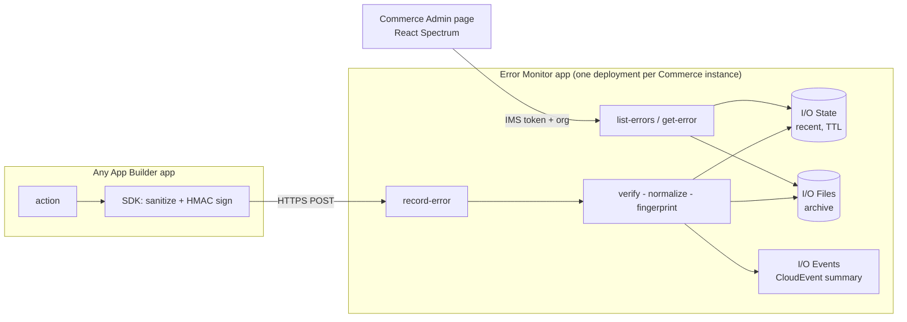

# Technical Design – Commerce App Builder Error Monitor

Version 0.1 (proof of concept) · Status: **draft for technical review** · Owner: _(assignee)_

## 1. Goals and scope
Provide one reusable way for App Builder applications serving an Adobe Commerce instance to **record sanitized errors**, keep recent ones queryable,
archive them durably, notify subscribers, and let operators **list and inspect** them from the Commerce Admin.

In scope: shared npm package; runtime actions (`record-error`, `list-errors`, `get-error`, `registration`); Admin dashboard; one separate sample consumer app.
Out of scope (PoC): alerting rules/UI, aggregation/analytics, multi-instance fan-in, log shipping, retention automation, role-level (RBAC) dashboard permissions.

## 2. Architecture

**Deployment model.** One Error Monitor deployment (workspace) per Commerce instance; `COMMERCE_INSTANCE_ID` is configuration, stamped server-side.
This makes "errors for the configured instance" a deployment boundary instead of a filter users could bypass. Consumer apps for that instance point at it.

**Ingest flow (`record-error`).** authenticate (HMAC) → parse → `normalizePayload` (server is authoritative; never trusts client sanitization) →
build `ErrorRecord` (server id, fingerprint, instance) → **State put (required; 503 on failure)** → **Files write (best effort, reported)** →
**Events publish if severity ≥ threshold (best effort, reported)** → `201 { id, stored:{state,archive}, event:{emitted,reason?} }`.
State is the system of record for recency; a Files or Events failure never loses the State record and is visible in the response and logs.

**Read flow.** `list-errors` / `get-error` are `require-adobe-auth` web actions; additionally the IMS org header must equal `IMS_ORG_ID` (fail closed if unset).
Records are validated, filtered to the configured instance, **re-sanitized on output**, and trimmed to a summary for lists.

## 2a. Platform compatibility
The SDK, `record-error`, State, Files and Events run entirely in App Builder, so they behave the same for **ACCS (SaaS, including sandboxes)** and **PaaS**.
Only the dashboard touches Commerce, through the Admin UI SDK:
- **ACCS:** the SDK is pre-installed. Enable it in *Stores → Settings → Configuration → Adobe Services → Admin UI SDK*, then *Configure extensions*.
- **PaaS:** Admin UI SDK ≥ 3.0.0 via Composer (included from 2.4.8).
- **Local `localhost` testing:** PaaS-only. On ACCS, test by deploying to a non-production workspace.
- **Caches:** ACCS has no CLI; saving the settings or *Refresh registrations* reloads menus.
- **Organization:** the App Builder project must belong to the same Adobe organization as the instance.
- **Admin hand-off:** the page follows the Admin UI SDK pattern. Every route renders `ExtensionRegistration` (`register`), which then `attach`es with the same extension ID and reads `imsToken` / `imsOrgId` from the shared context.

## 3. Data model – `ErrorRecord` v1
Authoritative machine-readable form: `packages/error-monitor-sdk/schema/error-record.v1.schema.json` (a test asserts code and schema keys cannot drift).

| Field | Notes |
|---|---|
| `schemaVersion` | `"1.0"`; unknown versions rejected with 400. |
| `id` | Server-generated `yyyymmddHHMMssSSS-xxxxxxxx` (UTC). Lexicographic = chronological; encodes the day used for State key and Files path. |
| `fingerprint` | SHA-256 (first 32 hex) of app, action, name, code, message with numbers/uuids/hex masked, top stack frame without line numbers. Groups equivalent errors. |
| `timestamp` / `receivedAt` | Client time clamped to [-30 d, +5 min] of server time, else server time. |
| `commerceInstanceId` | From configuration only. Client-supplied values are ignored (tested). |
| `severity` | `debug\|info\|warning\|error\|critical` (server strict; SDK coerces unknown to `error`). |
| `source` | `app` (required), `action`, `version`, `environment`. Name charset restricted. |
| `error` | `name`, `message` (≤1000), `code`, `stack` (≤30 lines, ≤4000 chars) – all sanitized. |
| `context` | **Allow-list**: `requestId`, `activationId`, `http{method,path(no query/fragment),status}`, `tags` (≤20 primitives; sensitive-looking keys masked). Everything else is dropped. |
| `redactions` | Count of masked occurrences (client + server). |

**Storage layout.** State key `e.<instance>.<yyyymmdd>.<id>` (TTL `STATE_TTL_SECONDS`, default 7 d). Files path `error-monitor/<instance>/<yyyy>/<mm>/<dd>/<id>.json` (private, not public files).
Event: CloudEvents 1.0, `type=EVENT_CODE`, `source=urn:uuid:<providerId>`, `id=<error id>`, data = id, fingerprint, instance, severity, app, action, error name, message ≤200 chars (**no stack, no context**).

## 4. Interfaces
| Action | Method / auth | Input | Output |
|---|---|---|---|
| `record-error` | POST, `raw-http`, **HMAC** (`x-em-timestamp`, `x-em-signature: v1=hex(HMAC-SHA256(key, ts + "." + body))`, ±300 s) | JSON payload ≤ 64 KB | 201/400/401/405/413/500/503 |
| `list-errors` | GET, IMS + org pin | `source=state\|archive` (default state), `limit` 1–100, `days` 1–31, `severity`, `app`, `date=YYYY-MM-DD` (archive) | `{instance, source, count, truncated, records[summary]}` |
| `get-error` | GET, IMS + org pin | `id` (strict pattern), optional `source` | `{instance, source, record}` (state first, then archive) |
| `registration` | IMS | – | Admin UI SDK menu registration |

Error bodies are generic (`unauthorized`, `forbidden`, `invalid_request` + field-level reasons that never echo submitted values, `storage_unavailable`, `service_misconfigured`).
Auth failure reasons go to logs only.

## 5. Security model
| Threat | Control | Evidence |
|---|---|---|
| Secrets/PII in error text end up stored/displayed | Allow-listed structure; key- and pattern-based masking on client, server, and output; query strings never stored | AC6 tests; negative control (11 tests fail if masking is disabled) |
| Forged / spoofed ingest | HMAC-SHA256, timing-safe compare, timestamp window, 64 KB cap | `ingest.test.js` (unsigned/tampered/wrong key/stale → 401, nothing written) |
| Caller labels records for another instance or chooses ids | Instance and id are server-side only | test "caller cannot choose the Commerce instance" |
| Unauthorized dashboard access | `require-adobe-auth` (platform validates the IMS token) is the security boundary. The extra `x-gw-ims-org-id == IMS_ORG_ID` check fails closed if unset, but the header is **sent by the browser**, so it is a consistency check only. Rejection of tokens from other orgs must be confirmed on deploy (README "Verify" #2). | `query.test.js`; deploy check pending |
| Injection / traversal via params (State key globs, Files paths) | Strict regexes for id, date, app, severity; id/date/instance are the only inputs used to build keys/paths | `query.test.js` invalid-params test |
| Credentials leaking via URL / page | The page gets the IMS token only from the Admin UI SDK shared context (`@adobe/uix-guest` `attach`), never from the URL | `admin-ui.test.js` |
| XSS in dashboard | React text nodes only; no HTML sinks (test greps component source); view-model re-masks | `viewmodel.test.js` |
| Monitoring harms the monitored app | SDK never throws, 2 s timeout, no redirects, client throttle | `client.test.js` |
| Secrets in repo | `.env` ignored, `.env.example` placeholders, runtime-assembled test fixtures, grep scan clean | design review checklist |

Crypto: HMAC-SHA256 and SHA-256 only (approved list). TLS: HTTPS enforced by the SDK; IMS token URL must be `https`. No certificate verification is disabled anywhere.

## 6. Key design decisions
| # | Decision | Alternatives considered | Rationale |
|---|---|---|---|
| D1 | Instance-per-deployment | Multi-tenant with `instance` filter | Isolation by construction; simpler authz. Cost: one deployment per instance. |
| D2 | HMAC-signed ingest instead of IMS for machine callers | IMS tokens from every consumer; direct action invoke | Consumers live in other namespaces/projects; avoids distributing IMS credentials. Cost: shared secret rotation (R5). |
| D3 | Server re-normalizes everything | Trust the SDK | SDK versions vary and callers can bypass the SDK. |
| D4 | Context is an allow-list | Accept arbitrary `extra` and redact | Redaction cannot be proven complete; not storing is the only guarantee. |
| D5 | Day-bucketed State keys, sort keys client-side | Single index document; one big key | Index documents race on read-modify-write; day prefixes bound scans. |
| D6 | Events carry a summary only | Full record in event | Subscribers (possibly external) get no stack/context; they link back via id. |
| D7 | Business logic dependency-injected; libs required lazily | Direct SDK calls | Testable offline; same code runs in production via `createRealDeps`. |

## 7. Risks and design considerations
| ID | Risk / consideration | Impact | Mitigation / decision |
|---|---|---|---|
| **R1** | **Error storms / feedback loops**: monitoring generates load or fails during an incident | Slows or breaks the app being monitored; cost spike | SDK: never throws, 2 s timeout, per-fingerprint throttle (5/min), 64 KB cap, fire-once (no retries). Server: bounded work per call, 503 only on State failure. The monitor's own actions do not report to themselves. **Next:** server-side per-fingerprint rate limit/dedupe counter. |
| **R2** | **Redaction is best effort** – pattern matching cannot find every secret; a bare short token with no label is invisible (pinned by a test) | A secret could be stored/displayed | Defence in depth (allow-list → client mask → server mask → output mask); no request bodies/headers accepted; `redactions` count surfaced; documented guidance: never put secrets in error messages; **Decision:** accept for PoC, require security review sign-off before production, add org-specific pattern hook (next step). |
| **R3** | **State is not a query engine**: recent listing relies on key-prefix scans; ordering is derived from key; very high volume makes lists slow/truncated | Incomplete or slow dashboard under load | Day-bucketed keys, scan cap 500/day, fetch cap 300/request, `truncated` flag in API and UI, 7-day TTL, Files for history. **Decision:** acceptable below ~hundreds of records/day/instance; above that add an aggregate/index store (next step). |
| **R4** | **Platform contract drift / unverified assumptions**: foreign-org token rejection by `require-adobe-auth`, `raw-http` body form, `state.list`, extension listing under *Configure extensions* | Dashboard or ingest fails on first deploy | Assumptions isolated (`query.js authorize`, `ingest.js getRawBody`, `registration`, `App.js useIms`) and listed in README "Verify on first deploy"; `npm run smoke` checks them; first-deploy findings recorded in test results. |
| **R5** | **Shared HMAC key**: distribution and rotation; replay within 5 min creates duplicates | Compromised key allows spam records | Min length 32, per-environment keys, secrets only via `.env`/CI secrets. **Next:** dual-key acceptance window for rotation; optional nonce store. Replays cannot read data. |
| **R6** | **Files archive growth**: one small file per record, no append, no automatic retention | Cost and listing latency over time | Day-partitioned paths; **Next:** scheduled purge/compaction action and retention setting (needs policy decision). |
| **R8** | **Admin UI SDK V1 is deprecated.** The dashboard uses `commerce/backend-ui/1`; Adobe now recommends V2 (`commerce/backend-ui/2`, App Management, Admin UI SDK ≥ 4.2.0) and will remove V1 in a future release. ACCS updates continuously, so removal could reach a sandbox without notice. | Dashboard menu disappears; backend unaffected | **Decision (needs approval):** keep V1 for the PoC (already built, works on ACCS and PaaS ≥ 3.0) and make V2 migration the first next step. **Switch to V2 now** if the sandbox no longer lists V1 extensions. Only `registration`, `ExtensionRegistration` and the web bootstrap change; the view-model, actions and SDK are reused. |
| **R7** | **Monorepo workspace dependency vs `aio app build`** (webpack must resolve the symlinked SDK) | Build fails or bundles wrong copy | Publish SDK to the internal registry and pin a version in consumers (D-open-3); within the monorepo verify bundle at first `aio app deploy`. |

## 8. Acceptance traceability
The brief lists six checks but enumerates five bullets; this design splits "retrievable from State and Files" into two and treats the remainder as written:

| # | Check | Automated evidence | Deployed evidence |
|---|---|---|---|
| AC1 | Records normalized to the agreed schema | `normalize.test.js`, `ingest.test.js` | `npm run smoke` AC1 |
| AC2 | Recent records retrievable from State | `query.test.js`, `integration.test.js` | smoke AC2 |
| AC3 | Archived records retrievable from Files | `query.test.js`, `integration.test.js` | smoke AC3 |
| AC4 | Configured Events notification emitted | `ingest.test.js`, `events.test.js` | smoke AC4 + Developer Console journal |
| AC5 | Dashboard shows details; safely handles empty/invalid | `viewmodel.test.js`, `query.test.js` | smoke AC5 + manual UI check |
| AC6 | Sensitive test values not exposed in records or dashboard output | AC6 tests in every suite; negative control | smoke AC6 + manual UI check |
**Please confirm this interpretation of "six" with the requester.**

## 9. Open decisions requiring approval
1. Repository: propose `commerce-appbuilder-error-monitor` (this structure) in the approved internal GitHub org – **approval pending**; no repository was created.
2. npm scope/registry for the SDK (placeholder `@commerce-ext`; e.g. internal GitHub Packages).
3. Retention: State TTL (7 d proposed) and Files retention (none yet).
4. Default Events severity threshold (`error`) and whether subscribers outside the org may receive them.
5. Dashboard authorization granularity (org-level today; Commerce ACL/role mapping later).
6. Identification of the approved non-production workspace/instance for the PoC (ACCS sandbox or PaaS).
7. Admin UI SDK V1 for the PoC with V2 migration next, or V2 now (risk R8).
