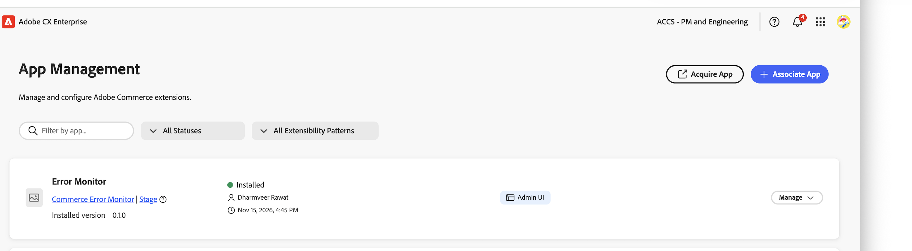
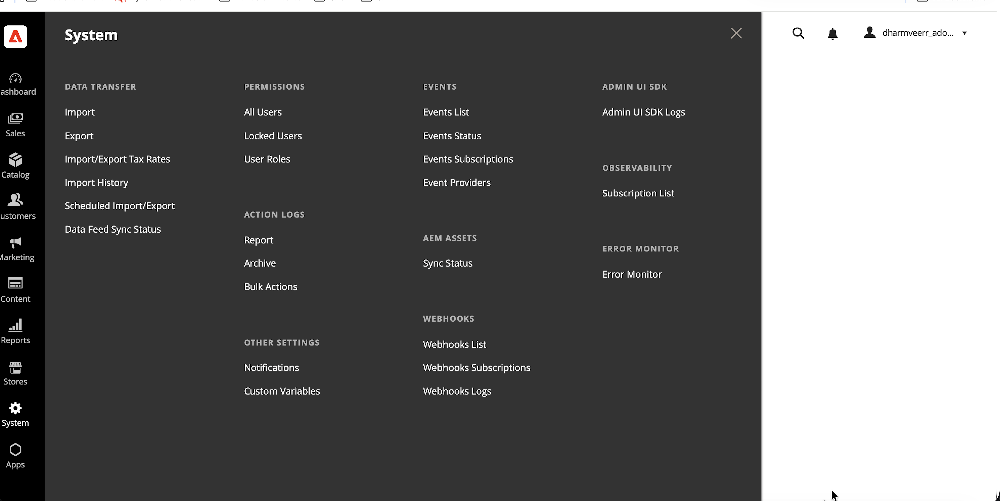
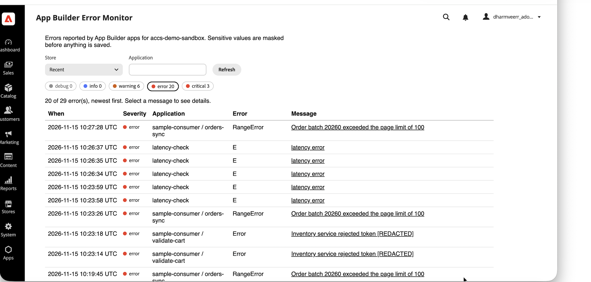

# Test Results

| | |
|---|---|
| Release | SDK 0.1.0, Error Monitor app 0.1.0 |
| Test run | 2026-11-15 |
| Environment | Node.js 24.21, Adobe I/O CLI 11.2.0, macOS |

## 1. Summary

| Area | Result |
|---|---|
| Automated tests (`npm test`) | **83 of 83 passed** |
| Clean-clone build (`npm ci`, `aio app build` for both apps) | **Passed** |
| Built action bundles exercised locally | **Passed** |
| Source-control hygiene (`.gitignore`) | **Passed** |
| Deployed to a non-production App Builder workspace; end-to-end check `npm run smoke` | **Passed** (section 5) |
| Commerce Admin installation and dashboard check | **Passed** (section 5.3, screenshots in section 6) |

## 2. Automated tests

The suite uses Node.js's built-in test runner. Adobe I/O State, Files and Events are replaced by in-memory equivalents with the same interface, so the tests need no network or credentials.

| Suite | Tests | Passed | Failed |
|---|---|---|---|
| SDK (`packages/error-monitor-sdk`) | 32 | 32 | 0 |
| Error Monitor app (`apps/error-monitor`) | 43 | 43 | 0 |
| Sample app (`apps/sample-consumer`) | 8 | 8 | 0 |
| **Total** | **83** | **83** | **0** |

**Test effectiveness check.** With all masking rules disabled in a scratch copy, 16 of the tests fail, including every sensitive-data test. This confirms that the sensitive-data tests detect a masking failure.

## 3. Acceptance checks

| # | Acceptance check | Automated evidence | Result |
|---|---|---|---|
| AC1 | Error records are normalized to the agreed schema | Records produced by `record-error` validate against `ErrorRecord` v1; the code and the JSON Schema are checked for consistency; the caller cannot set the instance or ID | Passed |
| AC2 | Recent records are retrievable from State | `list-errors` returns stored records newest first, including when the store returns keys in random order; filters by severity and application; `get-error` returns details | Passed |
| AC3 | Archived records are retrievable from Files | Archive listing by day and detail retrieval after the recent copy has expired | Passed |
| AC4 | The configured Events notification is emitted for a tested error | Exactly one CloudEvents 1.0 notification for an error from the sample app; none below the severity threshold; access token reused across calls | Passed |
| AC5 | The dashboard displays error details and safely handles empty or invalid results | Dashboard view-model covers loaded, empty, invalid and error states; malformed records are skipped and counted; invalid query parameters return `400`; storage problems return `503` | Passed |
| AC6 | Sensitive test values are not exposed in stored records or dashboard output | Synthetic passwords, tokens, keys, emails, card numbers and URL credentials are absent from State, Files, Events, API responses and dashboard output; the webhook reply contains no internal error text | Passed |

## 4. Build and deployment readiness

| Check | Result |
|---|---|
| Fresh copy without `node_modules`, `.env` or build output: `npm ci` | Passed |
| `aio app build` for the Error Monitor: 3 actions, the dashboard web bundle, and the 3 App Management actions | Passed |
| `aio app build` for the sample app: 2 actions | Passed |
| Built bundles executed locally: unsigned report → `401`; storage unavailable → `503`; wrong organization → `403`; invalid parameters → `400` | Passed |
| `.gitignore` excludes `.env`, `node_modules`, build output, generated files, caches and package files | Passed |
| Dependencies and App Management files generated by `@adobe/aio-commerce-lib-app` are committed, so a clean clone builds without extra initialization | Passed |

## 5. Verification in the deployed environment

Error Monitor deployed to a non-production App Builder **Stage** workspace; the sample app deployed to a **separate workspace** in the same organization. Run on 2026-11-15.

### 5.1 End-to-end check (`npm run smoke`)

| Check | Result |
|---|---|
| AC1 `record-error` accepts a signed report (`201`) and returns an ID | PASS |
| AC2/AC3 Stored in State and archived in Files | PASS |
| AC4 Events notification published | PASS |
| Report with an invalid signature rejected (`401`) | PASS |
| AC2 `list-errors` (State) returns the new record | PASS |
| AC5 `get-error` returns the record details | PASS |
| AC3 `list-errors` (Files archive) returns the new record | PASS |
| AC5 Empty result handled (`200`, zero records) | PASS |
| AC5 Invalid parameters rejected (`400`) | PASS |
| `list-errors` without an Adobe IMS token refused (`401`) | PASS |
| AC6 No synthetic sensitive value in any API output | PASS |
| AC6 Raw State copy contains no synthetic sensitive value | PASS |
| AC6 Raw Files copy | SKIP: Adobe I/O Files accepts requests only from Runtime actions. The archive copy is the same record as the State copy and is verified through `list-errors`. |

### 5.2 Sample app (separate workspace)

| Scenario | Result |
|---|---|
| `orders-sync` success: `200`, nothing recorded | PASS |
| `orders-sync` thrown error: generic `500` with `errorId`; record visible through `list-errors` | PASS |
| `orders-sync` sensitive values: stored message `Upstream rejected request for [REDACTED_EMAIL]: Authorization: Bearer [REDACTED]` | PASS |
| `orders-sync` returned `503`: response unchanged; recorded as `ErrorResponse 503` | PASS |
| `validate-cart` webhook, normal cart: `200 {op: success}`, not recorded | PASS |
| `validate-cart` webhook, business rule: `200 {op: exception, "Carts are limited to 50 items."}`, not recorded | PASS |
| `validate-cart` webhook, unexpected error: `200 {op: exception}` with reference ID; stored message `Inventory service rejected token [REDACTED]` | PASS |

### 5.3 Remaining checks in the Commerce instance

| Check | Method | Result | Date | Tester |
|---|---|---|---|---|
| Events notification visible in the Developer Console journal | Events registration → Debug Tracing / Journal | | | |
| App associated and installed through App Management | Setup guide, section 5 | PASS (Installed, version 0.1.0) | 2026-11-15 | D. Rawat |
| Dashboard opens under **System → Error Monitor** and lists, filters and shows details | Demo guide, step 7 | PASS (list, severity chips, application filter, masked values) | 2026-11-15 | D. Rawat |
| Dashboard data actions reject a token from another Adobe organization | Call `list-errors` with such a token | | | |

## 6. Screenshot evidence

These screenshots were taken in the Commerce sandbox. They support the results recorded above.

### 6.1 App installed in App Management

**Error Monitor** shows **Installed**, version **0.1.0**, with the **Admin UI** capability.

### 6.2 Menu entry in the Commerce Admin

The app adds **Error Monitor** under **System** in the Commerce Admin menu.

### 6.3 Dashboard: recent errors

The dashboard lists recent errors, newest first, with a count per severity. It shows errors from the sample app (`orders-sync`, `validate-cart`) and from the deployment checks. The token in the `validate-cart` message is shown as `[REDACTED]`.

