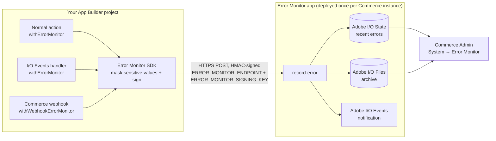
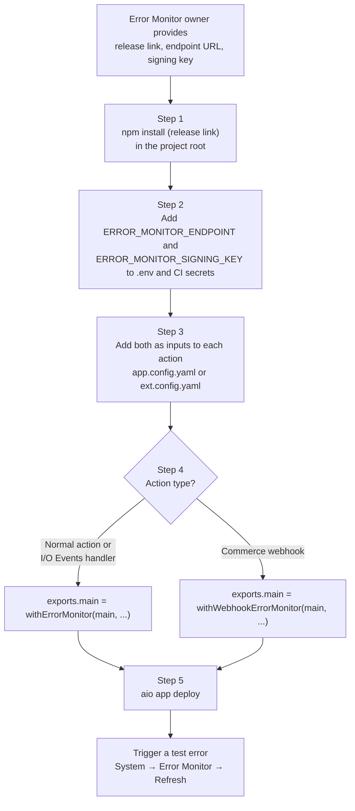
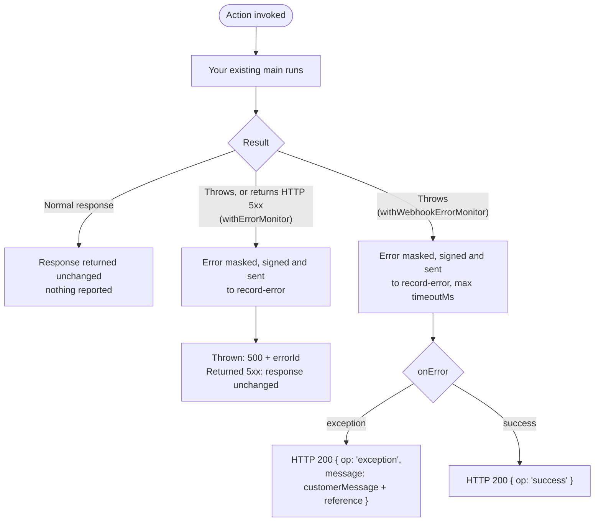

# Using the Error Monitor SDK in Your App Builder Project

This guide adds error reporting to an **existing App Builder project**: normal runtime actions, Adobe I/O Events handlers and Commerce webhooks. You install one package, add two settings, and wrap each action's export. Business logic does not change.

---

## 1. How it fits together



- **Package:** `@commerce-ext/error-monitor-sdk` (Node.js 20 or later, no runtime dependencies).
- **Where it goes:** the `package.json` in your project root, next to `app.config.yaml`. `aio app build` bundles it into each action, so one install serves every action. Do not install it inside an action folder. In a monorepo, the project root is the folder of the individual App Builder app.
- **What your project needs from the Error Monitor:** the `record-error` URL and the signing key. It does not need App Management, the Admin UI SDK or any Error Monitor code.

---

## 2. Distributing the package

The SDK is distributed as a package file (`.tgz`) attached to a **GitHub Release** of the Error Monitor repository, tagged `sdk-v<version>`.

### Publishing a version (SDK maintainers)

1. Set the version in `packages/error-monitor-sdk/package.json`, for example `0.2.0`.
2. Build the package file:
   ```bash
   cd packages/error-monitor-sdk
   npm test
   npm pack            # creates commerce-ext-error-monitor-sdk-<version>.tgz
   ```
3. On GitHub, create a release with tag `sdk-v<version>`, attach the `.tgz` file and publish it.
4. Copy the link of the attached file. It has this form:
   ```
   https://github.com/<github-org>/<repository>/releases/download/sdk-v<version>/commerce-ext-error-monitor-sdk-<version>.tgz
   ```

Do not replace the file of a published release; publish a new version instead. Package files are excluded from source control by `.gitignore`.

**Private repositories:** npm can download release files only from repositories that allow anonymous read access. If the repository is private, download the `.tgz` file and install it from a local path (`npm install ./vendor/commerce-ext-error-monitor-sdk-<version>.tgz`), or publish the package to your organization's private npm registry.

---

## 3. What you need

The Error Monitor owner (whoever deployed `apps/error-monitor`) provides these values. The developer adding the SDK does not generate them.

| Item | Where to get it |
|---|---|
| SDK release link (or `.tgz` file) | The repository's **Releases** page |
| `ERROR_MONITOR_ENDPOINT` | The `record-error` URL. The owner runs `aio app get-url` in `apps/error-monitor` and copies the `error-monitor/record-error` line. It has the form `https://<namespace>.adobeioruntime.net/api/v1/web/error-monitor/record-error`, where `<namespace>` is the Error Monitor workspace's Runtime namespace. Each environment (for example Stage and Production) has its own URL. |
| `ERROR_MONITOR_SIGNING_KEY` | A shared secret used to sign each error report, so the Error Monitor accepts reports only from your apps. It is the same value as the Error Monitor's `INGEST_SIGNING_KEY`. The owner creates it once with `openssl rand -hex 32` and shares it through your secret store or password manager, never by email or chat. |
| An application name | For example `orders-integration`; shown in the dashboard's *Application* column |

---

## 4. Step by step



Example project:

```
my-commerce-app/                       ← project root: run commands here
├── app.config.yaml                    ← step 3
├── package.json                       ← step 1
├── .env                               ← step 2 (never commit)
└── actions/
    ├── sync-orders/index.js           ← step 4a: normal action
    ├── order-event-handler/index.js   ← step 4b: I/O Events handler
    └── check-stock/index.js           ← step 4c: Commerce webhook
```

If the project was created with `npx @adobe/aio-commerce-lib-app init`, actions live under `src/commerce-extensibility-1/actions/` and are declared in `src/commerce-extensibility-1/ext.config.yaml`. The steps are the same.

### Step 1. Install the package

```bash
npm install https://github.com/<github-org>/<repository>/releases/download/sdk-v0.1.0/commerce-ext-error-monitor-sdk-0.1.0.tgz
```

Commit `package.json` and `package-lock.json`.

### Step 2. Add the settings to `.env`

```
ERROR_MONITOR_ENDPOINT=https://<namespace>.adobeioruntime.net/api/v1/web/error-monitor/record-error
ERROR_MONITOR_SIGNING_KEY=<the Error Monitor's INGEST_SIGNING_KEY>
```

In CI/CD pipelines, store both values as secrets.

### Step 3. Pass the settings to each action

Add two `inputs` to every action that reports errors, and keep `final: true` so callers cannot override them. Keep each action's other settings as they are; only the two inputs are new.

```yaml
application:
  runtimeManifest:
    packages:
      my-commerce-app:
        actions:
          sync-orders:
            function: actions/sync-orders/index.js
            web: 'yes'
            runtime: nodejs:22
            annotations:
              require-adobe-auth: true
              final: true
            inputs:
              ERROR_MONITOR_ENDPOINT: $ERROR_MONITOR_ENDPOINT
              ERROR_MONITOR_SIGNING_KEY: $ERROR_MONITOR_SIGNING_KEY
          order-event-handler:
            function: actions/order-event-handler/index.js
            web: 'no'
            runtime: nodejs:22
            annotations:
              final: true
            inputs:
              ERROR_MONITOR_ENDPOINT: $ERROR_MONITOR_ENDPOINT
              ERROR_MONITOR_SIGNING_KEY: $ERROR_MONITOR_SIGNING_KEY
          check-stock:
            function: actions/check-stock/index.js
            web: 'yes'
            runtime: nodejs:22
            annotations:
              require-adobe-auth: true
              final: true
            inputs:
              ERROR_MONITOR_ENDPOINT: $ERROR_MONITOR_ENDPOINT
              ERROR_MONITOR_SIGNING_KEY: $ERROR_MONITOR_SIGNING_KEY
```

In an App Management project, the same `inputs` go under your own package in `src/commerce-extensibility-1/ext.config.yaml`. That file starts at `runtimeManifest:` (there is no `application:` level). Do not edit the generated `app-management` package.

### Step 4. Wrap your actions

Only the export line changes. At runtime, the wrappers behave as follows:



If the Error Monitor is unreachable, reporting is skipped after the timeout and the action answers in the same way.

#### 4a. Normal action: `withErrorMonitor`

```js
const { withErrorMonitor } = require('@commerce-ext/error-monitor-sdk');

async function main(params) {
  // existing code, unchanged
  return { statusCode: 200, body: { synced: 3 } };
}

exports.main = withErrorMonitor(main, {
  source: { app: 'orders-integration', action: 'sync-orders', version: '1.4.0', environment: 'stage' },
});
```

| What the action does | What the wrapper does |
|---|---|
| Returns normally | Returns the response unchanged. Nothing is reported. |
| Throws an error | Reports it, then returns `500 { error: 'Internal Server Error', errorId }`. The `errorId` matches the record on the dashboard (it is empty if the report could not be delivered). |
| Returns a server error response (`statusCode` 500–599, including the App Builder `{ error: { statusCode, body } }` form) | Reports it and returns the response unchanged. Set `recordErrorResponses: false` to turn this off. |

#### 4b. I/O Events handler: `withErrorMonitor`

Use the same wrapper:

```js
const { withErrorMonitor } = require('@commerce-ext/error-monitor-sdk');

async function main(params) {
  // existing event handling, unchanged
}

exports.main = withErrorMonitor(main, {
  source: { app: 'orders-integration', action: 'order-event-handler', version: '1.4.0', environment: 'stage' },
});
```

Unhandled errors are reported and the action still ends with an error result, so the delivery is still treated as failed. Repeated failures of the same error are reported at most 5 times per minute per container.

#### 4c. Commerce webhook: `withWebhookErrorMonitor`

Commerce webhooks must answer with HTTP 200 and a webhook operation. A plain 500 would make Commerce show its generic fallback message, so webhooks use a dedicated wrapper:

```js
const { withWebhookErrorMonitor } = require('@commerce-ext/error-monitor-sdk');

async function main(params) {
  // existing webhook logic, unchanged
  if (outOfStock) return { statusCode: 200, body: { op: 'exception', message: 'This product is out of stock.' } };
  return { statusCode: 200, body: { op: 'success' } };
}

exports.main = withWebhookErrorMonitor(main, {
  source: { app: 'orders-integration', action: 'check-stock', version: '1.4.0', environment: 'stage' },
  onError: 'exception',      // or 'success' to let Commerce continue when the code fails
  customerMessage: 'We could not check stock right now. Please try again.',
  timeoutMs: 1000,
});
```

- **Normal answers** (`success`, your own `exception`, `add`, `replace`, …) pass through unchanged and are not reported.
- **Unexpected errors** are reported, then Commerce receives:
  - `onError: 'exception'` (default): `{ op: 'exception', message: '<customerMessage> (reference <id>)' }`. The Commerce operation stops.
  - `onError: 'success'`: `{ op: 'success' }`. The Commerce operation continues. Use this only where blocking the shopper is worse than skipping the check.
- **Internal error text is never sent to Commerce**, because webhook messages can be shown to shoppers.
- **If the Error Monitor is slow or unavailable**, the wrapper waits at most `timeoutMs` and then answers.
- Keep `timeoutMs` plus your own processing time below the webhook timeout configured in Commerce.
- Register the action as a webhook in Commerce as usual (in `app.commerce.config.ts` for App Management apps, or in the Commerce webhooks configuration). The wrapper does not change how the webhook is registered or authenticated.

#### 4d. Errors you handle yourself (optional)

```js
const { createErrorMonitor } = require('@commerce-ext/error-monitor-sdk');

async function main(params) {
  const monitor = createErrorMonitor({
    endpoint: params.ERROR_MONITOR_ENDPOINT,
    signingKey: params.ERROR_MONITOR_SIGNING_KEY,
    source: { app: 'orders-integration', action: 'sync-orders' },
  });
  try {
    await callErp(params.order);
  } catch (err) {
    await monitor.record(err, { severity: 'warning', context: { tags: { step: 'erp-sync' } } });
    // fallback handling
  }
  // ...
}
```

`record()` never throws.

#### TypeScript and ES module projects

Projects scaffolded with TypeScript (for example by `npx @adobe/aio-commerce-lib-app init` with an `app.commerce.config.ts`) use `import` syntax:

```ts
import { withErrorMonitor, withWebhookErrorMonitor } from '@commerce-ext/error-monitor-sdk';

export const main = withErrorMonitor(handler, { source: { app: 'orders-integration', action: 'order-event-handler' } });
```

The SDK does not include TypeScript type declarations yet. If the TypeScript build reports *"Could not find a declaration file for module '@commerce-ext/error-monitor-sdk'"*, add a file such as `src/types/error-monitor-sdk.d.ts` with this line:

```ts
declare module '@commerce-ext/error-monitor-sdk';
```

**What is sent.** The error name, message, code and stack, plus only these context fields: `requestId`, `activationId`, `http` (method, path without query string, status) and up to 20 short `tags`. Passwords, tokens, keys, emails, card numbers and URL credentials inside text are masked before sending. Masking is pattern-based, so do not deliberately put secrets in error messages.

### Step 5. Build, deploy and test

```bash
aio app build
aio app deploy
```

Make an action fail with a temporary test parameter, invoke it, then select **Refresh** on **System → Error Monitor** in Commerce Admin. The error appears under your application name.

### Step 6. Update or remove

- **Update:** `npm install <new release link>`, then `aio app deploy`, and commit the lock file.
- **Remove:** restore `exports.main = main;` and run `npm uninstall @commerce-ext/error-monitor-sdk`.

---

## 5. Checklist

- [ ] SDK installed in the project root; lock file committed
- [ ] `ERROR_MONITOR_ENDPOINT` and `ERROR_MONITOR_SIGNING_KEY` in `.env` (not committed) and in CI secrets
- [ ] Both inputs added to every wrapped action, with `final: true`
- [ ] Normal actions and event handlers use `withErrorMonitor`; webhooks use `withWebhookErrorMonitor`
- [ ] Webhook `customerMessage` contains no internal details
- [ ] A test error appears on the dashboard under the expected application name

## 6. Frequently asked questions

**Does every action folder need its own install?** No. One install in the project root serves all actions.

**Who gives me the endpoint and signing key?** The Error Monitor owner (see section 3). If either value is missing or wrong, your actions keep working normally, but errors are not reported; `record-error` rejects a wrong key with `401`.

**Can my app be in a different App Builder project or workspace than the Error Monitor?** Yes. It only needs the `record-error` URL and the signing key. Keep both projects in the same Adobe organization.

**Does reporting slow my actions down?** Only when an error is reported: at most 3 seconds by default (1 second for webhooks), or the `timeoutMs` you set. Successful calls are not affected.

**Which `timeoutMs` should I use?** For event handlers and background actions, `timeoutMs: 5000`: no shopper is waiting, and it allows for a cold start of the Error Monitor. For webhooks, keep it below the webhook's timeout in Commerce. If reporting takes longer, your action continues without an `errorId`; the error is usually still saved, but this is not guaranteed.

**What if the Error Monitor is unavailable?** The action behaves as it did before the wrapper was added; the report is skipped.

**Is there a working example?** Yes: [`apps/sample-consumer`](../apps/sample-consumer) contains `orders-sync` (normal action) and `validate-cart` (webhook).
